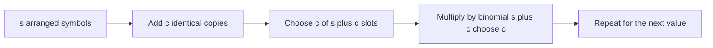

# Count Sequences 2

- Official problem: [AtCoder ABC425 E — Count Sequences 2](https://atcoder.jp/contests/abc425/tasks/abc425_e)
- USACO Guide ID: `ac-CountSequences2`
- Difficulty on the checked USACO Guide listing: Easy
- Topics: combinatorics, multinomial coefficients, Pascal's triangle
- Solution: [`solutions/ac-CountSequences2.cpp`](../../solutions/ac-CountSequences2.cpp)

## Paraphrased summary

For each test case, value `i` must appear exactly `C_i` times. Count the distinct sequences with those frequencies, modulo one shared integer `M`. The modulus is not guaranteed to be prime.

## Visualization

Build the sequence one value at a time. If `s` symbols are already arranged and the next value has `c` identical copies, choose which `c` of the `s+c` positions receive that new value.

## Approach

1. Read all test cases and find the largest frequency sum `S`.
2. Precompute every `C(n,k) mod M` for `0 <= k <= n <= S` with Pascal's recurrence.
3. For one case, maintain the number `s` of copies already placed.
4. For every frequency `c`, multiply the answer by `C(s+c,c)` and then set `s += c`.
5. Store Pascal's lower triangle in a flat array to avoid wasting half of a square table.

No modular division is used. This is essential because `M` may be composite.

## Why it is correct

Suppose the first several values have already formed one arrangement of length `s`. To add `c` indistinguishable copies of the next value, choose exactly `c` positions among the final `s+c` positions; the older symbols keep their relative order. Thus each old arrangement extends in exactly `C(s+c,c)` distinct ways. Conversely, removing the new value from any extended arrangement uniquely recovers its old arrangement and chosen positions. Multiplying these factors for every value therefore counts every valid final sequence exactly once. Pascal's recurrence computes the integer binomial coefficients before reduction, so the stored residues remain correct for any modulus.

## Complexity

- Precomputation: `O(S^2)` time and `O(S^2)` space, where `S <= 5000`.
- Each test case: `O(N)` time after precomputation.

## Verification notes

The repository checks both official samples, exact multinomial values for random small frequency lists under prime and composite moduli, one-symbol cases, and a maximum total length of 5000.
