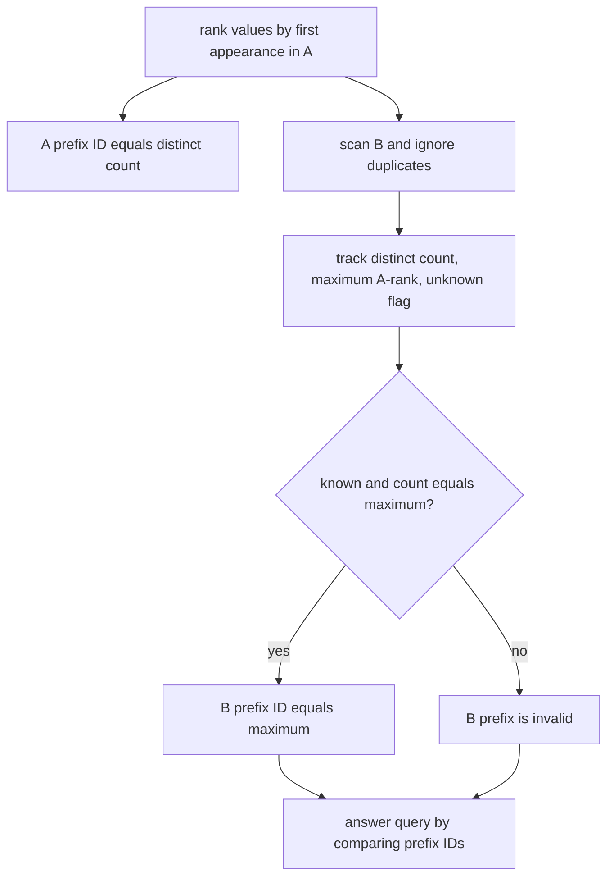

# Prefix Equality

- Source: AtCoder
- USACO Guide ID: `ac-PrefixEquality`
- Difficulty at selection: Easy (checked in [Guide source commit 6ee0cc9](https://github.com/cpinitiative/usaco-guide/blob/6ee0cc90b1b5477592fb71ddb1071dac1e1356f8/content/4_Gold/Hashing.problems.json))
- Original problem: [AtCoder ABC250 E](https://atcoder.jp/contests/abc250/tasks/abc250_e?lang=en)
- Tags: Prefixes, Sets, Coordinate Ranking
- Solution: [C++](../../solutions/ac-PrefixEquality.cpp)

## Problem Summary

Two integer arrays have equal length. For each query, decide whether the distinct values in one prefix of the first array equal the distinct values in one prefix of the second array. Multiplicity and order do not matter.

This is a paraphrased study summary. Refer to the official page for the complete statement and constraints.

## Visualization Description

Label each newly seen value in array `A` with ranks `1,2,3,...`. Every `A` prefix therefore owns the complete rank interval from `1` through its distinct count. Above each `B` prefix, show its distinct-count meter and largest-rank meter. That prefix matches some `A` prefix only when the two meters agree and no unknown value appeared.

## Approach

Assign rank `1` to the first distinct value appearing in `A`, rank `2` to the next new value, and so on. The set of any `A` prefix is exactly ranks `{1,...,k}`, where `k` is its distinct count.

While scanning `B`, process each distinct value once. Track its distinct count, the maximum `A` rank seen, and whether a value absent from all of `A` has appeared. A `B` prefix contains exactly `{1,...,k}` precisely when it has no unknown value and its distinct count equals its maximum rank. Store `k` as that prefix's deterministic set ID; otherwise store invalid. Queries reduce to comparing the two prefix IDs.

## Correctness

Every `A` prefix with ID `k` contains exactly the first `k` ranks. For a valid `B` prefix with maximum rank `k`, all seen ranks lie in `{1,...,k}`. If it has `k` distinct known ranks, it must contain every rank in that interval, so its set equals the `A` set with ID `k`. Conversely, any missing rank, unknown value, or different maximum prevents equality. Therefore equal stored IDs are equivalent to equal prefix sets.

## Complexity

- Expected time: `O(N + Q)` using hash tables
- Space: `O(N)`

## Verification

The smoke test is the official sample. The independent verifier compares every queried prefix pair against literal Python sets on thousands of random arrays and checks duplicates, disjoint values, reordered sets, large integers, and the maximum input size.
