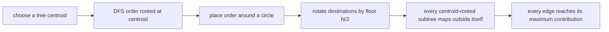

# 2020 - Village (Maximum)

- Official problem: [Codeforces 1387B2](https://codeforces.com/contest/1387/problem/B2)
- USACO Guide ID: `baltic-20-VillageMaximum`
- Difficulty on the checked USACO Guide listing: Easy
- Listing evidence: [Centroid Decomposition module at Guide commit `a426215`](https://github.com/cpinitiative/usaco-guide/blob/a4262152bce8c42a33ac73a631913a84b02a5ea4/content/5_Plat/Centroid.problems.json)
- Topics: tree centroid, permutation construction, edge contributions
- Solution: [`solutions/baltic-20-VillageMaximum.cpp`](../../solutions/baltic-20-VillageMaximum.cpp)

## Paraphrased summary

Every resident of a tree-shaped village must move to a different house, with exactly one resident ending in each house. Construct a destination permutation that maximizes the sum of all residents' travel distances, and print that maximum sum. Each road has unit length.

## Visualization

Cut any road. If its two sides contain `s` and `N-s` houses, no more than `min(s, N-s)` residents can cross in either direction. The best possible contribution of this road is therefore `2 * min(s, N-s)`.

In the circular DFS order, every rooted subtree is one interval. A centroid guarantees each interval has at most `floor(N/2)` positions, so a half-circle rotation makes that interval and its shifted copy disjoint.

## Approach

1. Compute subtree sizes iteratively and find a centroid.
2. Generate a DFS preorder rooted at that centroid; this keeps each rooted subtree contiguous.
3. Map the vertex at position `i` to the vertex at `(i + floor(N/2)) mod N`.
4. Sum `2 * min(subtree_size, N - subtree_size)` over all edges for the maximum value.

The circular shift is a permutation and has no fixed point because `N > 1` and the shift is positive.

## Why it is correct

For an edge, the same number of residents must cross from each side because the final assignment is a permutation. Thus its contribution cannot exceed twice the smaller side size. Root at a centroid. Every edge's lower subtree has at most half the vertices and occupies one contiguous DFS interval. Rotating by `floor(N/2)` maps this entire interval outside itself, so all its residents cross the edge; the same number enter from outside. The construction reaches the upper bound on every edge simultaneously, so the summed distance is globally maximum.

## Complexity

- Time: `O(N)`.
- Memory: `O(N)`.

## Verification notes

Random trees check that the output is a fixed-point-free permutation, recompute its literal all-pairs tree distances, and compare the printed total with the per-edge upper bound. Small cases also compare that bound with brute-force permutations. A 100,000-node chain checks maximum constraints and iterative traversal.
