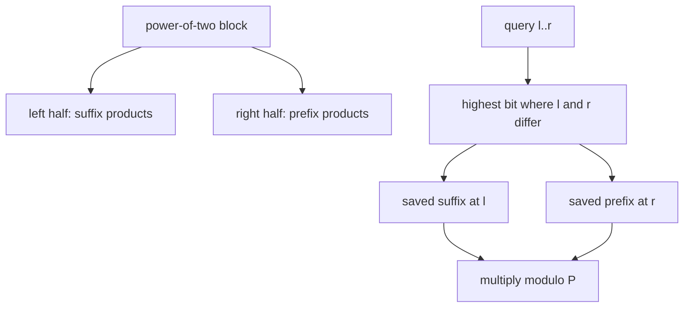

# Product on Segment

- Official problem: [CodeChef SEGPROD](https://www.codechef.com/problems/SEGPROD)
- USACO Guide ID: `cc-ProductOnSegment`
- Difficulty on the checked USACO Guide listing: Easy
- Topics: divide and conquer, static range queries, disjoint sparse table
- Solution: [`solutions/cc-ProductOnSegment.cpp`](../../solutions/cc-ProductOnSegment.cpp)

## Paraphrased summary

An immutable array and a possibly composite modulus are given. Decode a long online sequence of inclusive range queries, where each query depends on the preceding answer, and finally print the state after the last product query.

## Visualization

At each power-of-two level, split every block in half. Save all suffix products approaching the split from the left and all prefix products moving away from it on the right. Any non-singleton query crosses exactly one such split.

## Approach

Build a disjoint sparse table. At level `k`, each block has two halves of length `2^k`. Precompute products from every left-half index through the midpoint and from the midpoint through every right-half index. For different endpoints, the highest set bit of `left XOR right` selects the level whose split separates them. Multiplying the two saved values answers the range in constant time. A singleton returns its original reduced value.

Then decode queries in order. Every 64th query starts from the next pair in `B`; other queries start from the preceding sorted endpoints. Add the current state, reduce modulo `N`, sort the endpoints, query the table, and update the state.

## Why it is correct

At the selected level, the saved left suffix is exactly the product from `left` through the split and the saved right prefix is exactly the product after the split through `right`. Their multiplication contains every queried element once and in no other positions. Modular multiplication is associative, so the grouping is valid even when the modulus is composite. The online decoder follows the stated recurrence, so every generated range and final state are correct.

## Complexity

- Preprocessing: `O(N log N)` time and memory.
- Each query: `O(1)` time.

## Verification notes

Tests compare decoded queries with literal multiplication on random arrays, including zero values and composite moduli. They also cover singleton arrays, 64-query block boundaries, and the official sample.
