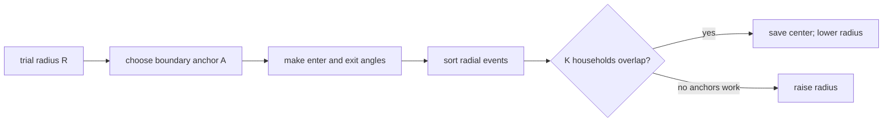

# 2006 — Antenna

- Official problem: [CEOI 2006 — Antenna](https://qoj.ac/problem/17234)
- Official analysis: [CEOI 2006 solutions](https://hsin.hr/ceoi2006/tasks/solutions.pdf)
- USACO Guide ID: `ceoi-06-antenna`
- Difficulty on the checked USACO Guide listing: Easy
- Listing evidence: [Sweep Line module at Guide commit `70bfb31`](https://github.com/cpinitiative/usaco-guide/blob/70bfb314cd0be2e8102215a8a3efb0a8cc558a06/content/5_Plat/Sweep_Line.problems.json)
- Topics: binary search on answer, radial sweep, circles, event sorting
- Solution: [`solutions/ceoi-06-antenna.cpp`](../../solutions/ceoi-06-antenna.cpp)

## Paraphrased summary

Given up to 500 household coordinates and a required count `K`, choose one circle that covers at least `K` households. Output the smallest possible radius and one center that achieves it, within the judge's numeric tolerance.

## Visualization

Fix a trial radius and one household `A` on the circle's boundary. The center can rotate on a radius-`R` circle around `A`. Every other nearby household is covered for one continuous interval of center angles. The trial radius works when at least `K-1` of those intervals overlap somewhere.

## Approach

1. Binary-search the radius.
2. For every possible boundary household `A`, consider centers at distance `R` from `A`.
3. A second household `B` can be covered only when `|AB| <= 2R`. If so, its valid center angles form `[alpha-beta, alpha+beta]`, where `alpha` points from `A` to `B` and `beta = acos(|AB|/(2R))`.
4. Duplicate every angular interval one full turn later, sort enters before exits at equal angles, and sweep a coverage counter starting at one for `A`.
5. When the counter reaches `K`, construct the corresponding center. The binary search keeps this witness whenever the radius is feasible.

## Why it is correct

For a fixed anchor and radius, the law of cosines gives exactly the angular interval of centers whose disk contains each other household. Thus the event sweep reaches `K` precisely when some radius-`R` disk through the anchor covers `K` households. Any smallest disk covering a chosen set can be moved or shrunk until at least one covered household touches its boundary, so testing every household as the anchor cannot miss an optimal disk. Feasibility is monotone in `R`, making binary search valid. The final stored event angle therefore supplies a center for the minimum radius to the requested precision.

## Complexity

- One feasibility check: `O(N^2 log N)` time and `O(N)` extra memory.
- With 80 binary-search iterations: `O(80 N^2 log N)` time and `O(N)` memory.

## Verification notes

Both official examples reproduce radii `2.5` and `sqrt(5)`. Random small cases are checked against an independent exhaustive oracle that enumerates every circle defined by two or three input points, then validates both the reported optimum and the number of households covered by the reported center.
