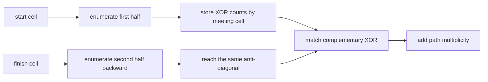

# Xor-Paths

- Source: Codeforces
- USACO Guide ID: `cf-1006F`
- Difficulty at selection: Easy (checked in [Guide source commit ef5573b](https://github.com/cpinitiative/usaco-guide/blob/ef5573bfbe9dc873486eed6502d6439d9c7fa97a/content/4_Gold/Meet_In_The_Middle.problems.json))
- Original problem: [Codeforces 1006F](https://codeforces.com/contest/1006/problem/F)
- Tags: Meet in the Middle, DFS, Grid Paths, XOR
- Solution: [C++](../../solutions/cf-1006F.cpp)

## Problem Summary

Count the monotone paths from the upper-left corner of a grid to the lower-right corner whose cell values XOR to a requested target. A move may go only right or down, and each grid dimension is at most twenty.

This is a paraphrased study summary. Refer to the official page for the complete statement and constraints.

## Visualization Description

Draw the anti-diagonal reached after half of every path's moves. Forward routes grow down and right from the start; backward routes grow up and left from the finish. At each meeting cell, place forward XOR frequencies on the left and pair them with the backward XOR that completes the target.

## Approach

Every complete path uses `N+M-2` moves. Enumerate the first half of those moves from the start and store a frequency map of partial XOR values for each meeting cell. Then enumerate the remaining moves backward from the finish.

Both partial XORs include their meeting cell. Therefore, if their values are `left` and `right` at a cell containing `v`, the complete XOR is `left XOR right XOR v`: the first two XORs cancel the duplicated `v`, and the last term restores its single occurrence. The needed forward value is consequently `target XOR right XOR v`.

## Correctness

Every monotone full path crosses the chosen anti-diagonal exactly once, so it has one unique forward half and one unique backward half at the same cell. The algorithm stores the forward half under its exact cell and XOR. During the corresponding backward enumeration, the complement equation accepts it exactly when the full path XOR equals the target. Thus every valid path is counted once and no invalid pair is counted.

## Complexity

- Time: `O(2^((N+M)/2))` partial paths, up to constant hash-map work per leaf
- Space: `O(2^((N+M)/2))`

## Verification

The smoke test uses the first official sample. The independent verifier compares against exhaustive path enumeration on hundreds of small random grids and checks single-cell, single-row, zero-valued, unreachable-target, 64-bit-value, and maximum `20 x 20` cases.
