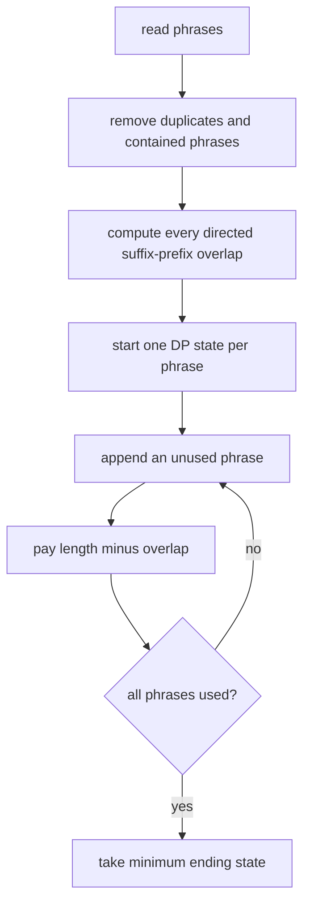

# Fullmetal Alchemist II

- Source: Codeforces Gym
- USACO Guide ID: `cf-104048K`
- Difficulty at selection: Easy (checked in [Guide source commit 6ee0cc9](https://github.com/cpinitiative/usaco-guide/blob/6ee0cc90b1b5477592fb71ddb1071dac1e1356f8/content/4_Gold/Hashing.problems.json))
- Original problem: [Codeforces Gym 104048K](https://codeforces.com/gym/104048/problem/K)
- Tags: Strings, KMP, Shortest Common Superstring, Bitmask DP
- Solution: [C++](../../solutions/cf-104048K.cpp)

## Problem Summary

Given at most ten lowercase phrases, find the minimum possible length of one string that contains every phrase as a contiguous substring. Duplicate phrases may appear.

This is a paraphrased study summary. Refer to the official page for the complete statement and constraints.

## Visualization Description

Write each surviving phrase on a transparent strip. Sliding strip `B` under strip `A` shows how many letters at the end of `A` can be reused at the beginning of `B`. A bitmask records which strips have already been placed, and an arrow records the final strip.

## Approach

First discard any phrase already contained in another; covering the longer phrase automatically covers it. Keep one copy of equal duplicates. KMP performs these checks exactly.

For each ordered pair `(i,j)`, compute the longest suffix of phrase `i` equal to a prefix of phrase `j`. Then use subset DP: `dp[mask][last]` is the shortest merged length for exactly the phrases in `mask`, ending at `last`. Appending `next` costs `|next| - overlap[last][next]`. This improves the factorial ordering search to `O(2^N N^2)` states and transitions.

## Correctness

Removed phrases need no independent placement because each is already inside a retained phrase. For retained phrases, any superstring order has a final phrase; adjacent phrases in that order can be shifted together by their maximum suffix-prefix overlap without losing either substring. The DP considers every possible retained-phrase order, and each transition adds exactly the characters not already covered by that overlap. Induction on the mask proves each state stores the best length for its ending phrase, so the minimum full-mask state is globally optimal.

## Complexity

- Time: `O(N^2 L + 2^N N^2)`, where `L` bounds phrase length
- Space: `O(2^N N + N^2)`

## Verification

Smoke tests include both official examples. The independent verifier compares against exhaustive superstring construction on small random inputs, including duplicates, contained strings, direction-sensitive overlaps, and repeated-character stress cases. A maximum-length case checks linear string preprocessing.
