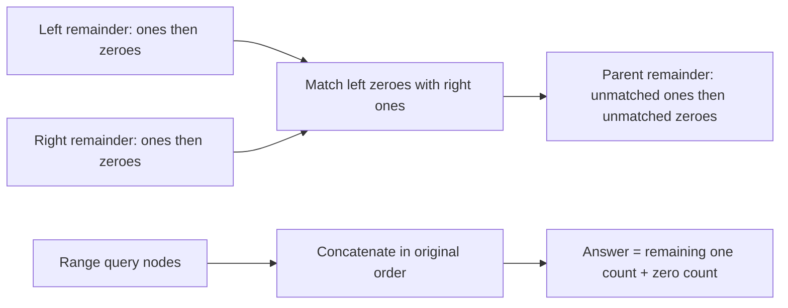

# 01 (Hard Version)

- Official problem: [Codeforces Gym 104380 H](https://codeforces.com/gym/104380/problem/H)
- USACO Guide ID: `cf-104380H`
- Difficulty on the checked USACO Guide listing: Easy
- Topics: segment tree, string reduction, associative summaries
- Solution: [`solutions/cf-104380H.cpp`](../../solutions/cf-104380H.cpp)

## Paraphrased summary

Maintain a binary string under single-bit flips. A query chooses a substring and repeatedly removes adjacent `01` pairs as long as possible. Report the minimum remaining length.

## Visualization

Treat zero as an opening token and one as a closing token. A reduced interval contains only unmatched ones followed by unmatched zeroes.

## Approach

Represent an interval by two counts: unmatched ones and unmatched zeroes after all deletions. To concatenate a left and right interval, create `min(left.zeroes, right.ones)` new cross-boundary pairs and subtract that number from the relevant counters. Build a segment tree with this associative, order-sensitive merge. A flip swaps the two leaf counters. A range query uses separate left and right accumulators so selected nodes stay in string order.

## Why it is correct

After no `01` remains, a binary string must have the form some ones followed by some zeroes; otherwise a zero occurring before a later one would imply an adjacent `01` somewhere at their boundary. When two reduced intervals are joined, the only possible new deletions pair trailing unmatched zeroes from the left with leading unmatched ones from the right. Matching as many as possible produces the unique counts of the fully reduced concatenation. Therefore each segment-tree merge preserves the exact reduced summary. The ordered query merge represents precisely the requested substring, and the sum of its two unmatched counts is its minimum possible final length.

## Complexity

- Build: `O(n)`.
- Flip: `O(log n)`.
- Substring query: `O(log n)`.
- Space: `O(n)`.

## Verification notes

Random updates and ranges are checked against a literal stack reduction. Deterministic tests include all-zero, all-one, fully canceling, nested reduction, one-character, and maximum-size operation streams.
