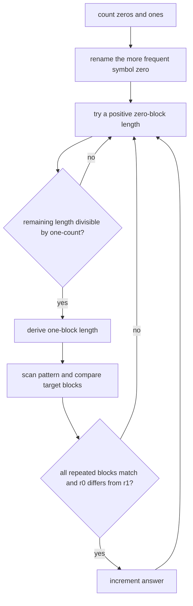

# Check Transcription

- Source: Codeforces
- USACO Guide ID: `cf-1056E`
- Difficulty at selection: Easy (checked in [Guide source commit 6ee0cc9](https://github.com/cpinitiative/usaco-guide/blob/6ee0cc90b1b5477592fb71ddb1071dac1e1356f8/content/4_Gold/Hashing.problems.json))
- Original problem: [Codeforces 1056E](https://codeforces.com/problemset/problem/1056/E)
- Tags: Strings, Enumeration, Rolling Hash
- Solution: [C++](../../solutions/cf-1056E.cpp)

## Problem Summary

A binary pattern is expanded by replacing every `0` with one nonempty string and every `1` with a different nonempty string. Count the ordered replacement pairs that produce the given lowercase target.

This is a paraphrased study summary. Refer to the official page for the complete statement and constraints.

## Visualization Description

Place the pattern above the target. Give each pattern symbol a proposed block width, then draw vertical cuts through the target. Blocks under equal symbols must match. The total-width equation determines one block width after the other is chosen.

## Approach

Let `c0` and `c1` be the symbol counts and `L0`, `L1` the replacement lengths. They must satisfy `c0*L0 + c1*L1 = |t|`. Rename the symbols if necessary so `c0 >= c1`, enumerate every positive `L0`, and derive `L1` from the equation.

For a feasible pair of lengths, scan the pattern while walking across the target. The first block for each symbol fixes its double rolling hash; later blocks for that symbol must match it. Finally reject equal replacements. Enumerating the more frequent symbol is important: there are at most `|t|/c0` candidates, and each scans `|s|` symbols, so the total scan work is linear in `|t|`.

## Correctness

Every valid replacement pair has positive lengths satisfying the width equation, so its `L0` is enumerated and its `L1` is derived exactly. During that candidate, the scan accepts precisely when every occurrence of each pattern symbol maps to the same target substring. The separate inequality test enforces that the two replacements differ. Thus every counted candidate is valid, and every valid ordered pair is counted once by its unique pair of lengths and contents.

## Complexity

- Time: `O(|t|)` expected, after `O(|t|)` hash preprocessing
- Space: `O(|t|)`

## Verification

Smoke tests cover both official examples. An independent brute-force verifier enumerates all nonempty replacement strings induced by short targets and compares literal expansion results. Large cases check the one-million-character target bound and the crucial more-frequent-symbol normalization.
