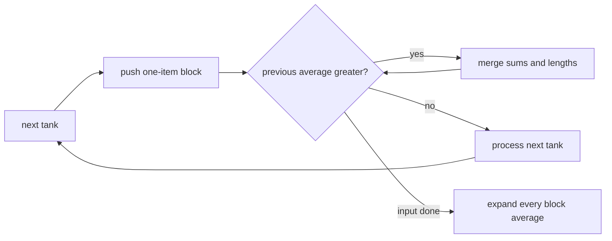

# Water Balance

- Official problem: [Codeforces 1299C — Water Balance](https://codeforces.com/problemset/problem/1299/C)
- USACO Guide ID: `cf-1299C`
- Difficulty on the checked USACO Guide listing: Easy
- Listing evidence: [Convex Hull module at Guide commit `70bfb31`](https://github.com/cpinitiative/usaco-guide/blob/70bfb314cd0be2e8102215a8a3efb0a8cc558a06/content/5_Plat/Convex_Hull.problems.json)
- Topics: greedy, pool adjacent violators, lower convex hull of prefix sums
- Solution: [`solutions/cf-1299C.cpp`](../../solutions/cf-1299C.cpp)

## Paraphrased summary

A row of tanks contains given water amounts. An operation may replace any contiguous segment by its average. After any number of operations, output the lexicographically smallest achievable sequence.

## Visualization

Treat each tank as a one-item block whose height is its amount. If a block on the left is taller on average than its right neighbor, the two cannot remain separate in the smallest answer: pour them together and replace both by their combined average. Continue leftward until the block heights are nondecreasing.

The same construction is the lower convex hull of prefix-sum points: each final block average is the slope of one hull edge.

## Approach

1. Store blocks as exact integer `(sum,length)` pairs.
2. Push each input value as a block of length one.
3. While the previous block average exceeds the last average, merge them.
4. Compare averages with cross multiplication, avoiding floating-point decisions.
5. Print each final block's average once for every tank it contains.

## Why it is correct

The first final value cannot exceed any prefix average, because averaging that prefix is a legal operation that would make the sequence lexicographically smaller. Hence it must equal the minimum prefix average, and every position through the last prefix attaining that minimum belongs to the same first block. Merging adjacent decreasing averages produces exactly this block. Removing it leaves the same problem on the suffix, so induction gives all subsequent blocks. Their averages are nondecreasing, and expanding them is achievable by averaging each block. Therefore the algorithm outputs the lexicographically smallest reachable sequence.

## Complexity

- Time: `O(N)` because every block is pushed once and popped at most once.
- Memory: `O(N)`.

## Verification notes

Tests include already sorted data, a fully decreasing array, equal averages, the official-style examples, and maximum-size input. Random small cases are checked using exact rational minimum-prefix selection, independently of the stack implementation.
