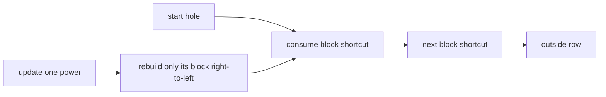

# Holes

- Official problem: [Codeforces 13E](https://codeforces.com/problemset/problem/13/E)
- USACO Guide ID: `cf-13E`
- Difficulty on the checked USACO Guide listing: Easy
- Topics: square-root decomposition, block rebuilding, jump queries
- Solution: [`solutions/cf-13E.cpp`](../../solutions/cf-13E.cpp)

## Paraphrased summary

A ball begins at a chosen position in a row. Each visited position sends it a positive distance to the right. Support changes to one jump distance and queries asking for the final visited position and total number of jumps before the ball leaves the row.

## Visualization

Split the row into blocks. From every position, draw one thick shortcut that represents all ordinary jumps until the path first leaves that block.

## Approach

For each starting hole, store the first destination outside its block, how many jumps reach that destination, and the last hole visited before leaving the block. Build these summaries from right to left because every jump goes to a larger index.

A query repeatedly consumes one block summary. An update changes one power and rebuilds only that hole's block; summaries in earlier blocks stop at the boundary and therefore remain valid.

## Why it is correct

Within one block, the stored summary follows the same first jump as the real ball. If that jump leaves the block, the summary is complete. Otherwise, the destination's already-correct summary is appended, so induction from right to left proves every block summary exact. A query concatenates these exact, consecutive path pieces until the destination is outside the row, counting every real jump once and preserving the true final visited hole.

## Complexity

- Build: `O(N)`.
- Update: `O(sqrt(N))`.
- Query: `O(sqrt(N))` block transitions.
- Memory: `O(N)`.

## Verification notes

Tests compare random updates and queries with literal jumping. They include one-hole rows, jumps that leave immediately, updates at block boundaries, repeated updates to the same hole, and maximum-size long chains.
