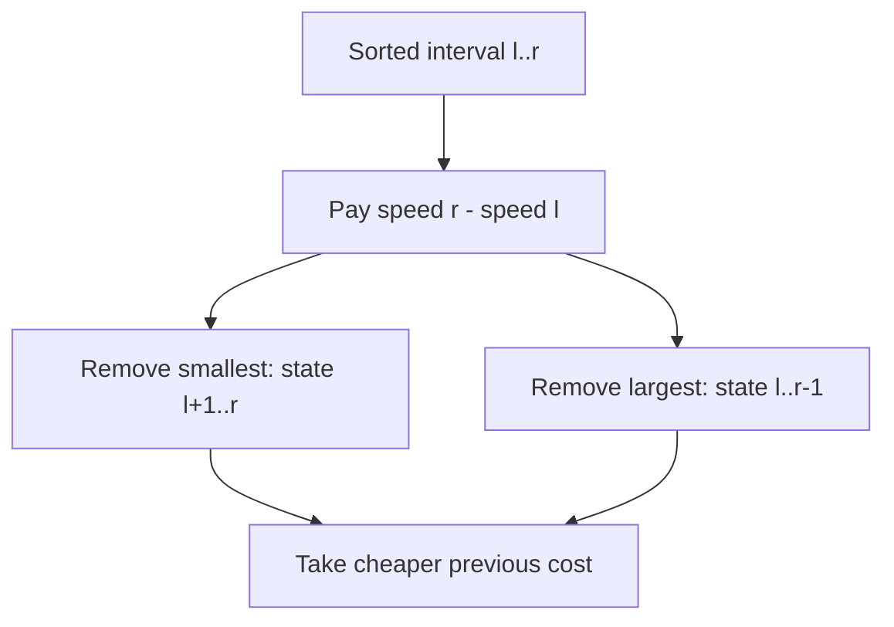

# The Sports Festival

- Official problem: [Codeforces 1509C](https://codeforces.com/contest/1509/problem/C)
- USACO Guide ID: `cf-1509C`
- Difficulty on the checked USACO Guide listing: Easy
- Topics: range dynamic programming, sorting, greedy structure
- Solution: [`solutions/cf-1509C.cpp`](../../solutions/cf-1509C.cpp)

## Paraphrased summary

Relay members can run in any order. After each new runner, the current discrepancy is the fastest speed seen minus the slowest speed seen. Choose an order that minimizes the sum of all prefix discrepancies.

## Visualization

Sort the speeds on a number line. Read the race backward: before the final runner was added, the used speeds can omit the current smallest or current largest value. Repeating this removal leaves a shrinking contiguous interval.

## Approach

1. Sort all speeds.
2. Define `dp[l][r]` as the minimum discrepancy sum for using exactly the values in sorted interval `[l,r]`.
3. A one-value interval costs zero.
4. For longer intervals, the current discrepancy is always `speed[r] - speed[l]`.
5. The last extreme added can be either `speed[l]` or `speed[r]`, leaving `[l+1,r]` or `[l,r-1]` before it.
6. Use `dp[l][r] = min(dp[l+1][r], dp[l][r-1]) + speed[r] - speed[l]`.

## Why it is correct

For any set of runners already used, only its minimum and maximum affect the current discrepancy. If a non-extreme value were the final member added to a sorted interval, removing it would leave the same minimum and maximum and would not reduce any earlier discrepancy; that runner can instead be moved earlier without making the cost worse. Therefore an optimal ordering can add an interval extreme last. The recurrence tries both possible extremes and adds the discrepancy forced by the whole interval. Induction on interval length proves every DP state, including the full interval, is optimal.

## Complexity

- Time: `O(N^2)`.
- Space: `O(N^2)`.

## Verification notes

The repository checks all official samples, every permutation for many small arrays, duplicates, already equal speeds, large 64-bit answers, and a maximum-size case with 2,000 members.
