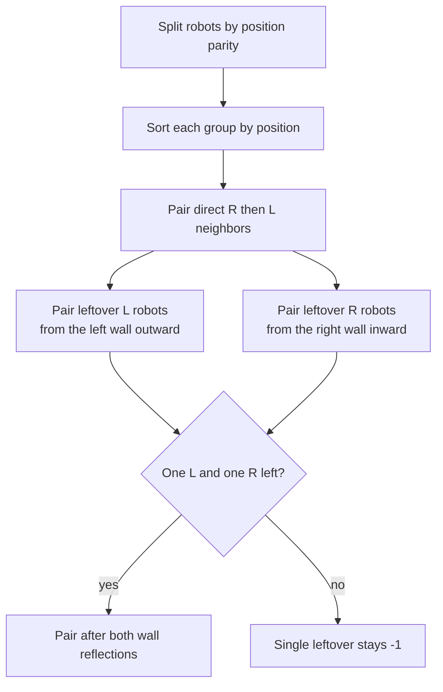

# Robot Collisions

- Official problem: [Codeforces 1525C](https://codeforces.com/problemset/problem/1525/C)
- USACO Guide ID: `cf-1525C`
- Difficulty on the checked USACO Guide listing: Easy
- Topics: sorting, stacks, parity, reflection
- Solution: [`solutions/cf-1525C.cpp`](../../solutions/cf-1525C.cpp)

## Paraphrased summary

Robots move at unit speed along a corridor between walls at `0` and `M`, reflecting instantly at a wall. Robots disappear when they meet at an integer coordinate. Report each robot's disappearance time, or `-1` if it never meets another robot.

## Visualization

Wall reflections become easier if the corridor is mentally unfolded. A left-moving robot at `x` can be viewed after reflection as continuing toward the virtual coordinate `-x`. A right-moving robot that reaches the other wall can similarly continue toward a mirrored copy beyond `M`.

For a same-parity pair, every numerator in the time formulas is even:

- direct `R ... L`: `(x_right - x_left) / 2`;
- two `L` robots: `(x1 + x2) / 2`;
- two `R` robots: `(2M - x1 - x2) / 2`;
- final `L ... R`: `(2M + xL - xR) / 2`.

## Approach

1. Sort robots by starting coordinate but retain their original indices.
2. Solve even and odd starting positions separately. Different parities can meet only at half-integer coordinates, where collisions do not count.
3. Scan left to right. Keep unmatched right-moving robots on a stack. A left-moving robot pairs with the stack top if possible; otherwise it joins the leftover-left list.
4. Pair leftover left-movers from left to right, because the nearest two return from the left wall and meet first.
5. Pair leftover right-movers from right to left for the symmetric reason.
6. If one robot remains in each list, pair those two after both reflect. Any single unpaired robot receives `-1`.

## Correctness argument

Direct `R-L` neighbors must meet before either can interact with a robot outside their interval, so removing each such adjacent pair is safe. After all direct pairs are removed, every leftover `L` lies before every leftover `R`. Among left-movers, the first two are the first possible pair after reflecting at wall `0`; induction pairs the rest. The symmetric statement holds for right-movers at wall `M`. At most one robot of each direction remains, and if both exist they meet after their wall reflections. These cases exhaust every same-parity robot, while opposite-parity robots can never collide at an integer coordinate.

## Complexity

- Time: `O(N log N)` for sorting.
- Space: `O(N)`.

## Verification notes

Tests include the official sample, an independent second-by-second reflected-motion simulator on random small corridors, multi-robot collisions, unmatched robots, both parities, and a maximum-size sorting stress case.
