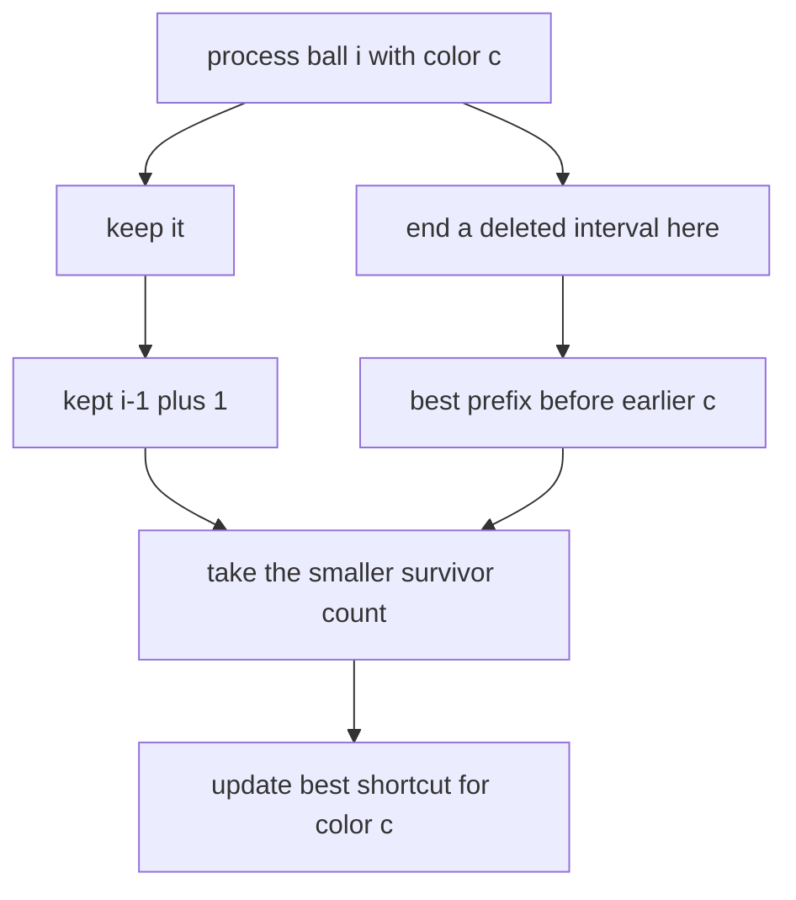

# Tenzing and Balls

- Source: Codeforces
- USACO Guide ID: `cf-1842C`
- Difficulty at selection: Easy (checked in [Guide source commit ef5573b](https://github.com/cpinitiative/usaco-guide/blob/ef5573bfbe9dc873486eed6502d6439d9c7fa97a/content/4_Gold/Conclusion.problems.json))
- Original problem: [Codeforces 1842C](https://codeforces.com/problemset/problem/1842/C)
- Tags: Dynamic Programming, Prefix Optimization
- Solution: [C++](../../solutions/cf-1842C.cpp)

## Problem Summary

A row contains colored balls. One operation chooses two equal-colored balls and removes the entire interval between and including them. Find the largest total number of balls that can be removed after any sequence of operations.

This is a paraphrased study summary. Refer to the official page for the complete statement and constraints.

## Visualization Description

Scan the original row left to right. Above each prefix, write the fewest balls that must survive. For every color, keep a shortcut back to the cheapest prefix immediately before an earlier ball of that color. Matching the current ball to that earlier endpoint erases the whole intervening block at no additional survivor cost.

## Approach

An optimal plan can be represented by disjoint deleted intervals: overlapping or nested deletions can be replaced by their useful outer interval. Let `kept[i]` be the minimum survivors in the first `i` original positions. Either position `i` survives, producing `kept[i-1]+1`, or it closes a deletion that began at an earlier equal color `j`, producing `kept[j-1]`.

Maintain `best_before[color]`, the minimum `kept[j-1]` over all earlier positions `j` of that color. This changes the transition from scanning every matching endpoint to constant time.

## Correctness

For each prefix, consider its last decision. If the final ball is not the right endpoint of a chosen deletion, it remains and the optimal cost is `kept[i-1]+1`. Otherwise it pairs with some earlier equal-colored ball `j`, deletes all of `[j,i]`, and leaves the optimal prefix cost `kept[j-1]`, whose minimum is stored in `best_before`. The recurrence checks every possible last decision, so induction on `i` proves `kept[i]` is optimal. Subtracting the minimum survivors from `N` gives the maximum removed count.

## Complexity

- Time: `O(N)` per test case
- Space: `O(N)`

## Verification

The smoke test uses the official sample. The independent verifier recursively tries every legal deletion sequence for random arrays of length at most eight, and also checks all-distinct colors, nested opportunities, several test cases, and a maximum-size all-equal array.
