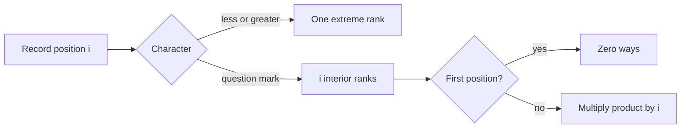

# Monocarp and the Set

- Official problem: [Codeforces 1886D — Monocarp and the Set](https://codeforces.com/contest/1886/problem/D)
- USACO Guide ID: `cf-1886D`
- Difficulty on the checked USACO Guide listing: Easy
- Topics: combinatorics, modular arithmetic, point updates
- Solution: [`solutions/cf-1886D.cpp`](../../solutions/cf-1886D.cpp)

## Paraphrased summary

The numbers `1..N` are inserted in some permutation order. After the first insertion, a record says whether each new number is a new minimum, a new maximum, or neither. After every single-character update to that record, count the compatible permutations modulo `998244353`.

## Visualization

Read each insertion as choosing the new number's rank among the elements seen so far.

## Approach

1. At zero-based record position `i`, there are `i+2` inserted values.
2. A new minimum or maximum has one allowed rank and contributes factor `1`.
3. A `?` must be an interior rank, so it contributes factor `i`.
4. At `i=0`, there is no interior rank; a leading `?` makes the answer zero.
5. Maintain the product of all later `?` factors.
6. For an update, divide out an old `?` factor with its modular inverse and multiply in a new one.

## Why it is correct

The sequence of relative insertion ranks uniquely determines a permutation, and every permutation determines one such rank sequence. At step `i`, the record independently allows either one extreme rank or exactly `i` interior ranks. Multiplying these choice counts gives the number of compatible permutations. The first position is the only zero factor and is tracked separately. Each update changes only one factor, so removing its old contribution and adding its new contribution preserves the exact product.

## Complexity

- Precomputation: `O(N log MOD)` with binary exponentiation for inverses.
- Each update: `O(1)`.
- Space: `O(N)`.

## Verification notes

The verifier enumerates all permutations through `N=8`, reconstructs their record strings, and compares every update answer with direct frequency counts. It also checks repeated updates, the special first position, all-question-mark strings, and a 300,000-character scale case.
