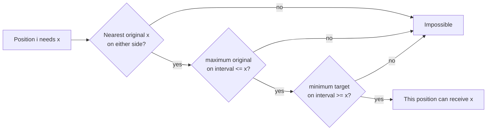

# Set To Max

- Official problem: [Codeforces 1904D2](https://codeforces.com/contest/1904/problem/D2)
- USACO Guide ID: `cf-1904D2`
- Difficulty on the checked USACO Guide listing: Easy
- Topics: segment tree, binary search, constructive reasoning
- Solution: [`solutions/cf-1904D2.cpp`](../../solutions/cf-1904D2.cpp)

## Paraphrased summary

Two arrays have the same length. An operation chooses a contiguous interval and replaces every value there by that interval's current maximum. Decide whether repeated operations can turn the first array into the second.

## Visualization

Suppose position `i` needs value `x`. Imagine stretching a paint roller from `i` to a position that originally contains `x`.

- An original value above `x` is a **tall wall**: it would make the roller's maximum too large.
- A target below `x` is a **protected low square**: painting it with `x` would make its final value impossible.
- If neither kind of blocker occurs, the source `x` can spread across the interval.

## Approach

1. Reject immediately if some `a[i] > b[i]`, because maximum operations never decrease a value.
2. Store the sorted positions of every value in the original array.
3. Build one segment tree. Each node stores:
   - the maximum original value in its interval;
   - the minimum target value in its interval.
4. For each position `i`, binary-search the closest original occurrence of `b[i]` to the left and to the right.
5. A candidate source `j` works exactly when the interval between `i` and `j` has `max(a) <= b[i]` and `min(b) >= b[i]`.
6. Accept only if every position has a working source.

Only the nearest source on each side is needed. If a farther source works, shortening its interval to the nearer equal value cannot introduce a blocker.

## Why the interval test is correct

**Necessity.** To create `x` at position `i`, some chosen interval must contain an existing `x`. If that interval contains an original value above `x`, its maximum can never be `x`. If it contains a position whose target is below `x`, that position would be raised past its required final value and could never decrease again.

**Sufficiency.** Take every validated operation in increasing order of its target value. An `x`-operation has an original `x` source and no original value above `x`, so its maximum is `x`. It never covers a target below `x`. It may temporarily cover larger-target positions, but those are correctly overwritten by later, larger operations. Thus all target values can be constructed.

## Complexity

- Time: `O(N log N)` per test batch, with total `N <= 200000`.
- Space: `O(N)`.

## Verification notes

The repository test suite checks the official sample, exhaustive reachable-state searches on small arrays, random targets, blocker cases on both sides, and a maximum-length case.
