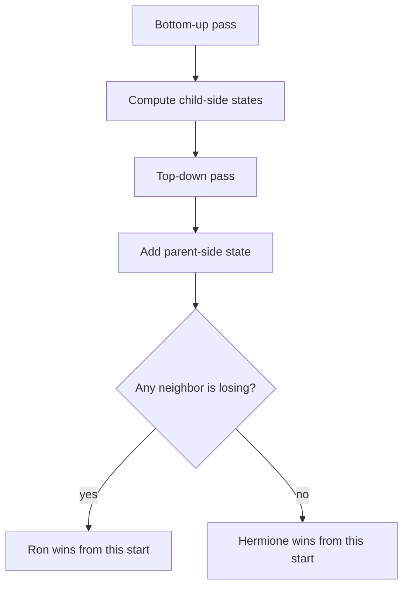

# Game on Tree

- Official problem: [Codeforces 1970C3](https://codeforces.com/contest/1970/problem/C3)
- USACO Guide ID: `cf-1970C3`
- Difficulty on the checked USACO Guide listing: Easy
- Topics: game DP, trees, rerooting
- Solution: [`solutions/cf-1970C3.cpp`](../../solutions/cf-1970C3.cpp)

## Paraphrased summary

For each query, a stone starts at one tree node. Ron and Hermione alternately move it to an unvisited neighbor, with Ron first. A player who has no move loses. Determine the winner under optimal play for every requested start.

## Visualization

Once the stone crosses an edge, that edge can never be crossed backward because the previous node is active. A position is therefore described by the current node and the one blocked incoming edge. It is winning if any allowed neighbor leads to a losing position.

## Approach

1. Root the tree at any node and create an iterative parent-before-child order.
2. In reverse order, compute `down[v]`: whether the player to move at `v`, with its parent blocked, can win.
3. A state is winning exactly when at least one allowed neighbor has a losing state.
4. In forward order, count all losing neighbor states visible from each node, including the already computed parent side.
5. The start at `v` is winning iff this count is positive.
6. For child `c`, remove `c`'s contribution from the count. The remainder gives the state at `v` with the edge to `c` blocked, which becomes `c`'s parent-side value.

Both passes are iterative so a path with 200,000 nodes cannot overflow the call stack.

## Why it is correct

Tree movement can never revisit a node, so after the first move the only relevant blocked direction is the edge just used. By normal-play game induction, a directed state is winning exactly when it has a move to a losing directed state. The bottom-up pass computes this rule for every child-side state. The top-down pass then supplies the missing state from the parent direction; subtracting one child's contribution gives exactly the choices available when arriving from that child. Consequently every directed edge state and every unblocked starting state is evaluated by the same game rule, so each query winner is correct.

## Complexity

- Preprocessing time: `O(N)`.
- Query time: `O(1)` each.
- Space: `O(N)`.

## Verification notes

The repository checks both official examples, exhaustive game-state minimax on hundreds of random small trees, paths, stars, and a 200,000-node path for stack safety and linear performance.
