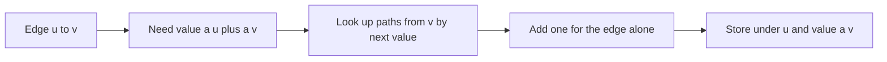

# Fibonacci Paths

- Official problem: [Codeforces 2176D — Fibonacci Paths](https://codeforces.com/contest/2176/problem/D)
- USACO Guide ID: `cf-2176D`
- Difficulty on the checked USACO Guide listing: Easy
- Topics: directed graphs, dynamic programming, sorting, maps
- Solution: [`solutions/cf-2176D.cpp`](../../solutions/cf-2176D.cpp)

## Paraphrased summary

Every vertex of a directed graph carries a positive integer. Count directed paths of at least two vertices whose values may start arbitrarily but every later value equals the sum of the previous two. Return the count modulo `998244353`.

## Visualization

Treat an edge `u -> v` as the first two terms. A legal next edge `v -> w` is determined by the value requirement `a[w] = a[u] + a[v]`.

## Approach

1. Give every directed edge the key `a[u] + a[v]` and sort edges by this key in descending order.
2. Maintain `ways[u][x]`: the number of already computed Fibonacci paths starting at `u` whose second vertex has value `x`.
3. For edge `u -> v`, start with the one-edge path.
4. Add `ways[v][a[u] + a[v]]`, because precisely those paths can continue the two starting values.
5. Add that count to `ways[u][a[v]]` and to the global answer.

The edge used by any continuation has a strictly larger endpoint sum because all labels are positive. Its state is therefore ready before the current edge.

## Why it is correct

Every counted state begins with a real directed edge. For `u -> v`, the lookup accepts exactly paths whose next value is `a[u] + a[v]`, so attaching them produces all and only valid Fibonacci paths beginning with this edge. The one-edge path is valid by definition. Descending edge sums make every required continuation available. Each path has one unique first edge, so adding all edge-state counts neither omits nor duplicates a path. Values strictly increase after the first two terms, so a counted walk cannot revisit a vertex and is automatically simple.

## Complexity

- Time: `O(M log M)` for sorting and ordered-map operations.
- Space: `O(N+M)` map entries and edge storage.

## Verification notes

The independent verifier enumerates every simple directed path in small random graphs and checks the value recurrence directly. It also tests equal labels, cycles, disconnected components, many edges sharing one label, large 64-bit labels, and a 200,000-edge scale case.
