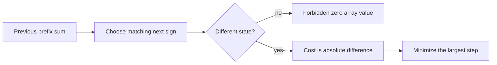

# Signs of Prefix Sums

- Official problem: [Codeforces 2260D — Signs of Prefix Sums](https://codeforces.com/contest/2260/problem/D)
- USACO Guide ID: `cf-2260D`
- Difficulty on the checked USACO Guide listing: Easy
- Topics: dynamic programming, prefix sums, minimax optimization
- Solution: [`solutions/cf-2260D.cpp`](../../solutions/cf-2260D.cpp)

## Paraphrased summary

A string specifies whether every prefix sum of a nonzero integer array is positive, negative, or zero. Find the smallest possible maximum absolute array value, or report that no such array exists.

## Visualization

Choose the prefix sums themselves. Consecutive chosen states determine an array value by subtraction.

## Approach

1. Include the empty prefix sum `p[0]=0`.
2. Use the seven candidate prefix sums from `-3` through `3`.
3. Let the DP value for a candidate be the smallest maximum step used so far.
4. For each sign character, try every candidate with that sign.
5. Reject an unchanged prefix sum because it would create `a[i]=0`.
6. Relax with the larger of the old cost and the new absolute difference.
7. The smallest final state is the answer; no reachable state means `-1`.

Small alternating representatives of each sign show that any feasible string has cost at most three. Candidate values in this range also preserve every possible solution of cost one or two, so the bounded DP contains an optimum.

## Why it is correct

Every DP transition selects a prefix sum with the required sign and a nonzero difference from its predecessor. Thus each DP path corresponds to a legal array, and its stored maximum difference is exactly that array's cost. Conversely, an optimal prefix-sign realization can be normalized into `[-3,3]`; following those normalized prefix sums is one of the DP transition sequences. The DP takes the minimum over all such sequences, so its final minimum is precisely the optimal cost. If there is no path, no legal array exists.

## Complexity

- Time: `O(49N)`, which is `O(N)`.
- Space: `O(7)` beyond the input string.

## Verification notes

The verifier exhaustively compares all short sign strings with a separate bounded array-value search, checks the official examples, rejects a first or repeated zero prefix, and runs alternating and long homogeneous strings at the total input limit.
