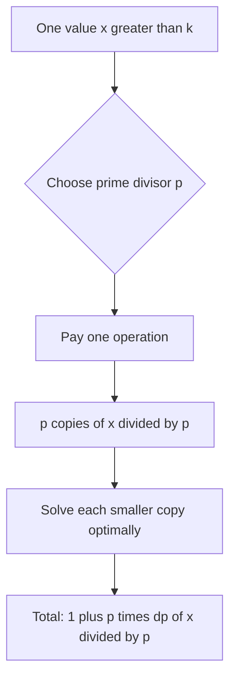

# Prime Destruction

- Official problem: [Codeforces 2266E — Prime Destruction](https://codeforces.com/contest/2266/problem/E)
- USACO Guide ID: `cf-2266E`
- Difficulty on the checked USACO Guide listing: Easy
- Topics: dynamic programming, divisibility, sieve
- Solution: [`solutions/cf-2266E.cpp`](../../solutions/cf-2266E.cpp)

## Paraphrased summary

A multiset starts with positive integers. In one operation, choose a value `x > 1` and one of its prime divisors `p`, then replace that occurrence by `p` copies of `x/p`. Find the minimum operations needed until every remaining value is at most `k`.

## Visualization

Each operation grows a small decision tree. If the first split of `x` uses `p`, all `p` children are identical and can be finished optimally in the same way.

## Approach

1. Let `dp[x]` be the minimum cost for one occurrence of `x`.
2. Set `dp[x]=0` for every `x <= k`.
3. For each larger `x` in increasing order, try every distinct prime divisor `p`.
4. The first operation produces `p` copies of `x/p`, so this choice costs `1 + p * dp[x/p]`.
5. Take the minimum choice. A smallest-prime-factor sieve lists the candidate primes quickly.
6. Sum `dp[a[i]]` over the original multiset.

## Why it is correct

For one `x > k`, every legal first operation must choose some prime divisor `p`. It costs one operation and leaves `p` identical, smaller values `x/p`. These copies do not interact, so finishing them costs exactly `p * dp[x/p]` when each is solved optimally. Trying every prime divisor and taking the minimum therefore gives the optimal `dp[x]`. Increasing order is valid because `x/p < x`. Finally, operation trees descending from different original elements are independent, so adding their individual optimal costs gives the global optimum.

## Complexity

- Sieve: `O(N log log N)` once for `N = 200000`.
- Per test case: `O(n log n)` in a loose bound, and near `O(n log log n)` in practice.
- Space: `O(n)`.

## Verification notes

The verifier compares every small `(x,k)` with a literal breadth-first search over reachable multisets, checks random arrays by additivity, includes the official examples, and stresses maximum input with powers of two and primes.
