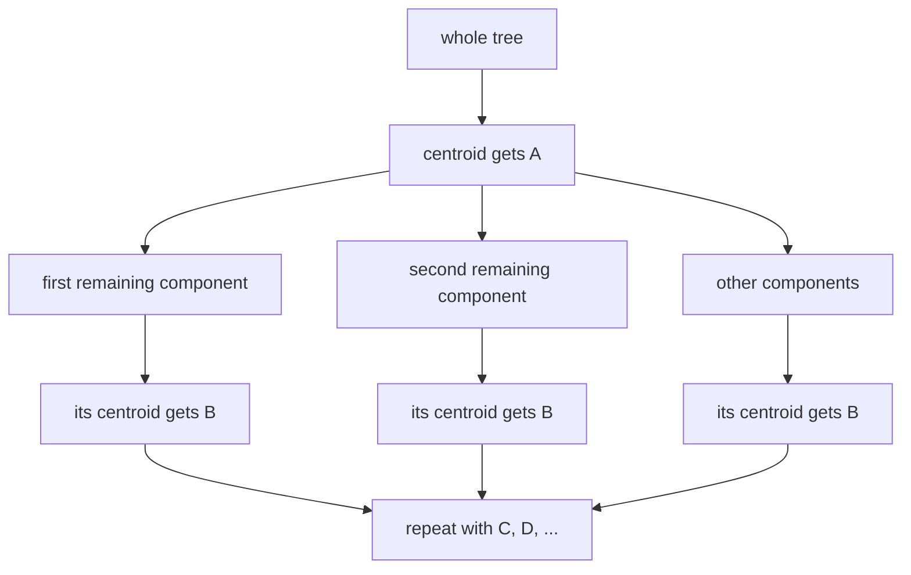

# Ciel the Commander

- Official problem: [Codeforces 321C](https://codeforces.com/contest/321/problem/C)
- USACO Guide ID: `cf-321C`
- Difficulty on the checked USACO Guide listing: Easy
- Listing evidence: [Centroid Decomposition module at Guide commit `31e29ac`](https://github.com/cpinitiative/usaco-guide/blob/31e29ac00c138376c6f443b0129181261997c270/content/5_Plat/Centroid.problems.json)
- Topics: centroid decomposition, trees, divide and conquer
- Solution: [`solutions/cf-321C.cpp`](../../solutions/cf-321C.cpp)

## Paraphrased summary

Assign each tree vertex one rank from `A` through `Z`. Any two vertices with the same rank must have a strictly higher-ranked vertex somewhere on their connecting path. Produce a valid assignment or report that the alphabet is insufficient.

## Visualization

A centroid becomes the highest-ranked representative of its component, then its removal separates independent smaller components.

Because every centroid leaves pieces no larger than half of its component, the decomposition has logarithmic depth.

## Approach

For each active component, collect its vertices and compute subtree sizes. A vertex is a centroid when every piece created by removing it contains at most half of the component. Give that centroid the component's current letter, mark it removed, and process each resulting neighbor component with the next letter.

The implementation uses an explicit job stack and iterative component traversals. Only the balanced decomposition levels—not a potentially deep original tree—control the process.

## Why it is correct

Consider two vertices given the same letter at decomposition level `d`. They cannot belong to one component job, because each job chooses only one centroid at that level. Therefore they lie in two different components formed after some earlier centroid was removed. Their original-tree path must pass through that separating centroid, whose decomposition level is smaller and whose letter is therefore higher-ranked. This proves the required path property. Every vertex is eventually chosen because each step removes one centroid and recursively covers every remaining component.

## Complexity

- Time: `O(N log N)` because each vertex participates in at most one component per decomposition level.
- Memory: `O(N)`.
- Maximum letters used: `O(log N)`; fewer than 26 for the official limit.

## Verification notes

Random trees validate that equal-letter pairs have a smaller-letter vertex on their literal BFS path. Additional checks confirm every letter is in `A`–`Z`. A 100,000-node chain verifies iterative traversal and balanced decomposition at the official maximum size.
