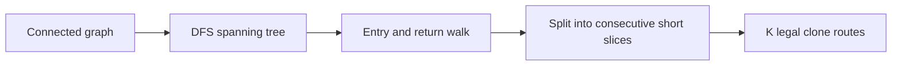

# Underground Lab

- Official problem: [Codeforces 781C — Underground Lab](https://codeforces.com/contest/781/problem/C)
- USACO Guide ID: `cf-781C`
- Difficulty on the checked USACO Guide listing: Easy
- Topics: graph traversal, Euler-style DFS walk, constructive algorithms
- Solution: [`solutions/cf-781C.cpp`](../../solutions/cf-781C.cpp)

## Paraphrased summary

A connected graph must be covered by `K` nonempty walks. Every vertex must occur in at least one walk, and no walk may list more than `ceil(2N/K)` visited vertices. Construct any valid set of walks.

## Visualization

Choose a DFS spanning tree. Record a node when first entering it and record its parent after returning from each child. The result is one continuous walk of at most `2N-1` entries.

## Approach

1. Run iterative DFS from vertex 1, ignoring edges whose destination was already visited.
2. Append a vertex when entering it. When its frame finishes, append its parent before continuing.
3. This produces a valid walk that covers every vertex and has at most `2N-1` entries.
4. Let `limit = ceil(2N/K)` and split the walk into consecutive chunks of at most `limit` entries.
5. If fewer than `K` chunks are needed, give each remaining clone the single-vertex route `1`.

The iterative traversal avoids stack overflow on a 200,000-vertex path.

## Why it is correct

DFS reaches every vertex because the graph is connected. Each consecutive pair in the recorded list is a traversed spanning-tree edge: either DFS moves to a child or returns to its parent. Therefore every consecutive slice is a legal walk. A tree edge is used at most once downward and once upward, so the whole list has at most `2N-1` entries. Splitting it into chunks of size at most `ceil(2N/K)` needs no more than `K` chunks because its size is less than `2N`. All original vertices appear on entry, so the chunks cover the graph. Extra one-vertex routes are nonempty and legal.

## Complexity

- Time: `O(N+M)`.
- Space: `O(N+M)`.

## Verification notes

The repository validates generated output rather than requiring one exact construction. It checks route counts and limits, edge-by-edge movement, total vertex coverage, random connected multigraphs, self-loops, stars, paths, and a 200,000-vertex constraint-scale graph.
