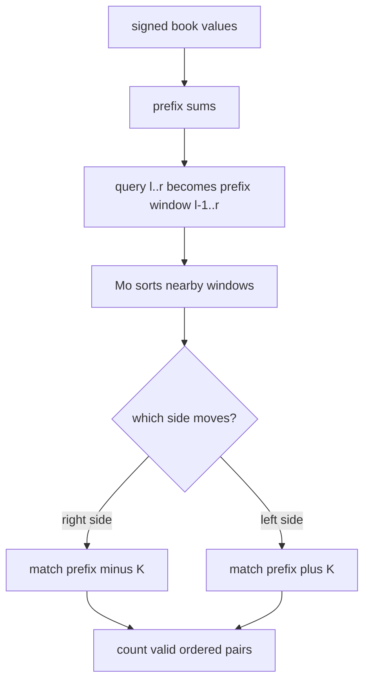

# Ann and Books

- Official problem: [Codeforces 877F](https://codeforces.com/contest/877/problem/F)
- USACO Guide ID: `cf-877F`
- Difficulty on the checked USACO Guide listing: Easy
- Topics: Mo's algorithm, prefix sums, offline range queries
- Solution: [`solutions/cf-877F.cpp`](../../solutions/cf-877F.cpp)

## Paraphrased summary

Each book contributes a nonnegative number of either math or economics problems. For every query interval, count its nonempty subarrays where the math total minus the economics total equals a fixed value `K`.

## Visualization

Give math books positive weight and economics books negative weight. A wanted subarray becomes two prefix-sum points whose vertical difference is exactly `K`; Mo's ordering slides one prefix window between queries.

## Approach

Convert each type-2 value to its negative and compute prefix sums. A subarray from `i+1` through `j` is valid exactly when `prefix[j] - prefix[i] = K`. Thus a book query `[l,r]` asks for ordered prefix pairs inside `[l-1,r]`.

Process these prefix windows with Mo's algorithm. When adding a new right endpoint, count existing values equal to `prefix[right]-K`. When adding a new left endpoint, count existing values equal to `prefix[left]+K`. Reverse those operations when removing endpoints. Coordinate compression makes every frequency lookup constant time.

## Why it is correct

The signed transformation makes each subarray sum equal its math total minus its economics total. Prefix subtraction therefore gives an exact one-to-one mapping between valid nonempty subarrays and ordered prefix pairs with difference `K`. The four Mo update operations add or remove precisely the pairs involving the moved boundary while respecting which prefix index is earlier. Therefore the maintained total equals the requested subarray count for every window.

## Complexity

- Prefix and compression setup: `O(N log N)`.
- Offline queries: `O((N + Q) sqrt(N))` pointer work with `O(1)` updates.
- Memory: `O(N + Q)`.

## Verification notes

Random small queries are checked against direct subarray enumeration. Tests include positive, negative, and zero `K`; zero-valued books; repeated prefix sums; singleton queries; all-books queries; and a maximum-size all-zero case whose answer is `N(N+1)/2`.
