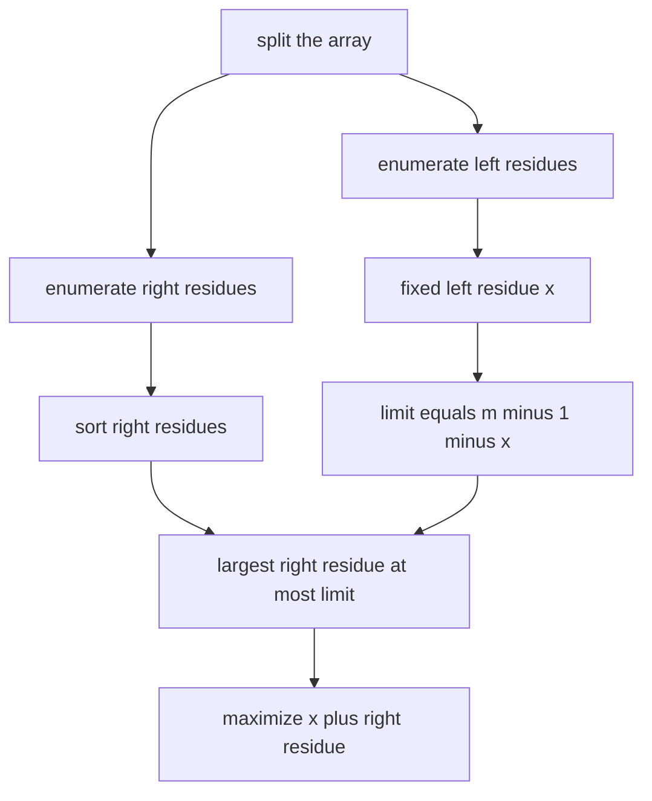

# Maximum Subsequence

- Source: Codeforces
- USACO Guide ID: `cf-888E`
- Difficulty at selection: Easy (checked in [Guide source commit ef5573b](https://github.com/cpinitiative/usaco-guide/blob/ef5573bfbe9dc873486eed6502d6439d9c7fa97a/content/4_Gold/Meet_In_The_Middle.problems.json))
- Original problem: [Codeforces 888E](https://codeforces.com/contest/888/problem/E)
- Tags: Meet in the Middle, Subset Sums, Binary Search, Modular Arithmetic
- Solution: [C++](../../solutions/cf-888E.cpp)

## Problem Summary

Choose any subset of up to thirty-five array positions, possibly no positions, to maximize the chosen sum after taking it modulo a given positive number.

This is a paraphrased study summary. Refer to the official page for the complete statement and constraints.

## Visualization Description

Place all subset residues from the right half on a number line from `0` to `m-1`. For a fixed left residue `x`, shade the safe interval from `0` through `m-1-x`. The best partner is the rightmost dot in that interval, found by upper bound. Show that dots beyond the boundary wrap to a smaller residue.

## Approach

Enumerate all subset sums modulo `m` for each half and sort the right residues. For a left residue `x`, binary-search the largest right residue no greater than `m - 1 - x`. Adding that partner stays below `m`, so the result is simply their sum.

A wrapped pair cannot beat this choice: pairing `x` with the empty right subset already gives `x`, while any wrap subtracts `m` and produces less than `x`. Therefore only the greatest non-wrapping partner needs to be tested.

## Correctness

Every chosen full subset splits uniquely into a left subset and a right subset. For a fixed left residue `x`, the algorithm selects the largest right residue whose addition does not wrap, which maximizes all non-wrapping results. Any wrapping result is smaller than `x`, and the empty right subset makes `x` available, so no wrapping result can be optimal for that left subset. Taking the maximum over every left subset therefore gives the global maximum residue.

## Complexity

- Time: `O(N * 2^(N/2))`
- Space: `O(2^(N/2))`

## Verification

The smoke tests include both official samples. The independent verifier compares against exhaustive subset enumeration on random small arrays and checks `m = 1`, values larger than the modulus, repeated residues, wrap-heavy inputs, and a maximum-size case.
