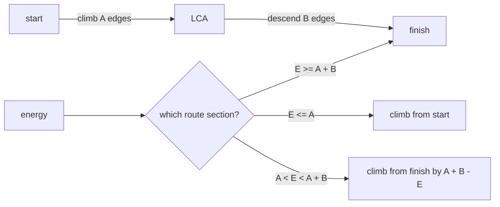

# Sloth Naptime

- Official problem: [Codeforces Gym 102694C](https://codeforces.com/gym/102694/problem/C)
- USACO Guide ID: `cfgym-102694C`
- Difficulty on the checked USACO Guide listing: Easy
- Listing evidence: [Binary Jump module at Guide commit `81e547a`](https://github.com/cpinitiative/usaco-guide/blob/81e547ad50a16109b5b5ed582bc6a6397479ce2b/content/5_Plat/Binary_Jump.problems.json)
- Topics: lowest common ancestor, binary lifting, tree paths
- Solution: [`solutions/cfgym-102694C.cpp`](../../solutions/cfgym-102694C.cpp)

## Paraphrased summary

A sloth starts at one vertex of a tree and wants to travel toward another. Each edge costs one unit of energy. For every query, find where the sloth stops after using its available energy, or the destination if it has enough energy to finish the route.

## Visualization

The unique route bends at the lowest common ancestor (LCA) of its endpoints.

If the answer is on the descending half, it is easier to locate it by climbing from the finish through the unwalked suffix.

## Approach

Root the tree and build `up[level][vertex]`, the ancestor `2^level` edges above each vertex. This table supports both LCA queries and fixed-distance upward jumps.

For endpoints `start` and `finish`, let `meeting` be their LCA. The path contains `A = depth[start] - depth[meeting]` upward edges followed by `B = depth[finish] - depth[meeting]` downward edges.

- If energy is at least `A + B`, return `finish`.
- If energy is at most `A`, climb exactly that far from `start`.
- Otherwise, climb `A + B - energy` edges from `finish`.

## Why it is correct

The tree has exactly one route between the query endpoints, and the LCA divides it into the two stated sections. The three energy cases cover every possible stopping point. Binary lifting composes powers-of-two ancestor jumps whose lengths sum to the requested distance, so the returned vertex is exactly that many edges above its chosen endpoint. On the second section, climbing the unwalked suffix from the finish identifies the same route position the sloth reaches from the start.

## Complexity

- Preprocessing: `O(N log N)` time and memory.
- Each query: `O(log N)` time.

## Verification notes

Random tests reconstruct each unique route with breadth-first search and index it directly. Maximum-depth chain tests exercise iterative preprocessing, every lifting bit, zero energy, excess energy, and equal endpoints.
