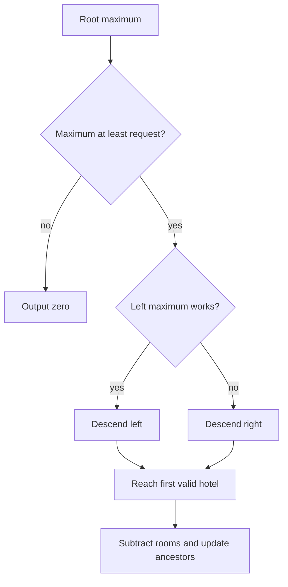

# Hotel Queries

- Official problem: [CSES 1143 — Hotel Queries](https://cses.fi/problemset/task/1143)
- USACO Guide ID: `cses-1143`
- Difficulty on the checked USACO Guide listing: Easy
- Topics: segment tree, first valid position
- Solution: [`solutions/cses-1143.cpp`](../../solutions/cses-1143.cpp)

## Paraphrased summary

Hotels are arranged from left to right and each has some free rooms. For every arriving group, place it in the first hotel with enough capacity, reduce that capacity, or output zero if no hotel works.

## Visualization

A max segment tree labels every interval with its largest remaining capacity. At each fork, go left if the left interval can hold the group; otherwise go right.

## Approach

1. Build a segment tree whose node value is the maximum free-room count in its interval.
2. If the root maximum is below a group's size, output zero.
3. Otherwise descend from the root. Choose the left child when its maximum is large enough; only choose the right child when the left cannot work.
4. At the reached leaf, subtract the group's size.
5. Recompute maximums on the path to the root.

## Why it is correct

The root rejects a group exactly when no leaf has enough rooms. During a successful search, choosing the left interval whenever it contains any valid hotel cannot skip a smaller valid index. Moving right happens only after proving that no hotel in the entire left interval works. Therefore the reached leaf is the first valid hotel. Updating that leaf and every ancestor restores each node's interval maximum, so the invariant holds for the next group.

## Complexity

- Build: `O(n)`.
- Each group: `O(log n)`.
- Space: `O(n)`.

## Verification notes

The verifier compares random capacities and requests with a direct left-to-right simulation, checks exact-fit and rejected groups, runs the official example, and exercises two hundred thousand hotels and groups.
