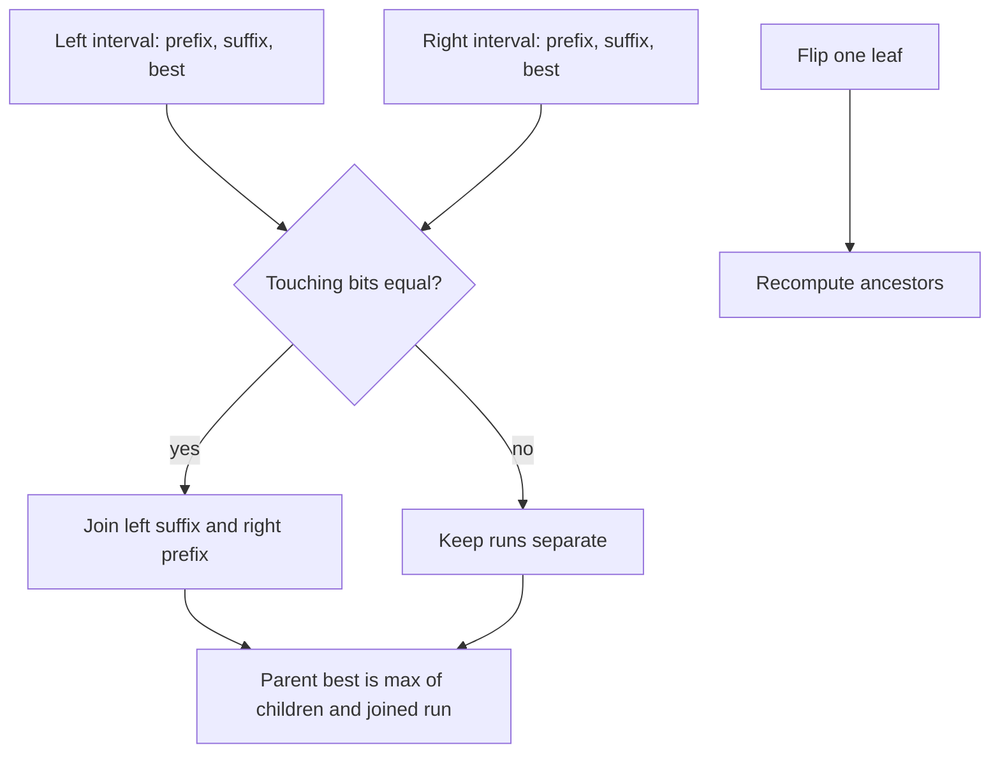

# Bit Inversions

- Official problem: [CSES — Bit Inversions](https://cses.fi/problemset/task/1188)
- USACO Guide ID: `cses-1188`
- Difficulty on the checked USACO Guide listing: Easy
- Topics: segment tree, longest run, point updates
- Solution: [`solutions/cses-1188.cpp`](../../solutions/cses-1188.cpp)

## Paraphrased summary

A binary string changes one position at a time. After every flip, report the longest contiguous block made entirely of one repeated bit.

## Visualization

Each tree node summarizes one interval. The prefix and suffix are the only runs that might connect through a parent boundary.

## Approach

Store an interval's length, first and last bits, longest equal-bit prefix, longest equal-bit suffix, and longest run anywhere. When two nodes meet, their boundary runs combine only if the left node's last bit equals the right node's first bit. A point flip changes one leaf, after which the nodes on its root path are rebuilt.

The tree root always summarizes the complete string, so its `best_length` is the answer.

## Why it is correct

A longest run in a combined interval lies entirely inside the left child, entirely inside the right child, or crosses their shared boundary. The merge checks exactly those three possibilities. A crossing run exists exactly when the touching bits agree, in which case it has length `left.suffix + right.prefix`. The prefix extends into the right child only when the whole left child is one run; the suffix rule is symmetric. Thus every merged node stores correct values. A flip changes only intervals containing its leaf, so rebuilding those ancestors restores the invariant and the root's best value is correct after every update.

## Complexity

- Build: `O(n)`.
- Each flip and answer: `O(log n)`.
- Space: `O(n)`.

## Verification notes

Tests compare random flip sequences with a direct scan, cover alternating and uniform strings, repeated flips, both endpoints, non-power-of-two lengths, and a full `200,000`-bit / `200,000`-update case.
