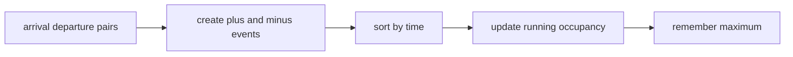

# Restaurant Customers

- Official problem: [CSES 1619 — Restaurant Customers](https://cses.fi/problemset/task/1619)
- USACO Guide ID: `cses-1619`
- Difficulty on the checked USACO Guide listing: Easy
- Listing evidence: [Sweep Line module at Guide commit `5addb3e`](https://github.com/cpinitiative/usaco-guide/blob/5addb3eedcaddea38292dd70129482ae7057155c/content/5_Plat/Sweep_Line.problems.json)
- Topics: sweep line, event sorting, intervals
- Solution: [`solutions/cses-1619.cpp`](../../solutions/cses-1619.cpp)

## Paraphrased summary

Each restaurant visit has an arrival time and a later departure time. Determine the maximum number of customers simultaneously present.

## Visualization

Replace every interval by a `+1` event at its left endpoint and a `-1` event at its right endpoint. A left-to-right scan turns overlapping intervals into a running occupancy counter.

## Approach

1. Create `(arrival,+1)` and `(departure,-1)` for each customer.
2. Sort the `2N` events chronologically.
3. Add each event's change to the current customer count.
4. Record the greatest current count seen during the sweep.

## Why it is correct

Immediately after all events through time `t` are processed, the running total equals arrivals through `t` minus departures through `t`, which is exactly the number of active visits. The occupancy can change only at an event time, so examining every updated total includes every possible maximum. Thus the recorded maximum is the answer.

## Complexity

- Time: `O(N log N)` for sorting.
- Memory: `O(N)` for the event list.

## Verification notes

Tests cover disjoint visits, nested visits, long overlap chains, large timestamps, the official sample, and randomized intervals checked by directly counting active visits at every event time.
