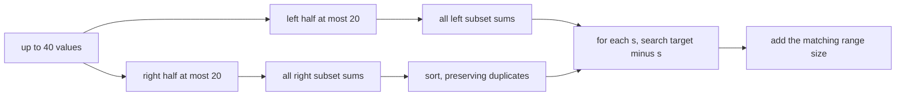

# Meet in the Middle

- Source: CSES
- USACO Guide ID: `cses-1628`
- Difficulty at selection: Easy (checked in [Guide source commit ef5573b](https://github.com/cpinitiative/usaco-guide/blob/ef5573bfbe9dc873486eed6502d6439d9c7fa97a/content/4_Gold/Meet_In_The_Middle.problems.json))
- Original problem: [CSES 1628](https://cses.fi/problemset/task/1628/)
- Tags: Meet in the Middle, Subset Sums, Binary Search
- Solution: [C++](../../solutions/cses-1628.cpp)

## Problem Summary

Given up to forty positive integers and a target, count the subsets whose elements add exactly to the target. Equal values at different positions are still different choices.

This is a paraphrased study summary. Refer to the official page for the complete statement and constraints.

## Visualization Description

Draw the input as two boxes of at most twenty numbers. Beneath each box, expand a small example into a list of every subset sum, including zero for the empty subset. Connect a left sum `s` to every right occurrence of `target - s`; duplicate right sums have separate arrows because they represent separate subsets.

## Approach

Split the array into two halves. Enumerate every subset sum in each half; each list has at most `2^20` entries instead of the impossible full `2^40` search. Sort the right list. For every left sum `s`, binary-search the equal range for `target - s` in the right list and add its length to the answer.

Do not deduplicate either list. Two different subsets can have the same sum, and each left-right subset pair is a different answer.

## Correctness

Every full subset has one unique decomposition into its chosen left-half indices and chosen right-half indices. Its total is the left subset sum plus the right subset sum. The algorithm considers its left sum and counts the right subset exactly when that right sum equals `target - left sum`. Thus every valid full subset is counted once. Conversely, every counted pair combines to the target, so no invalid subset is included.

## Complexity

- Time: `O(N * 2^(N/2))`, including generation and sorting
- Space: `O(2^(N/2))`

## Verification

The smoke test uses the official sample. The independent verifier compares against complete `2^N` enumeration on random small positive arrays and checks repeated values, unreachable targets, the empty-half boundary, and a maximum-size all-ones case whose answer is `C(40,20)`.
