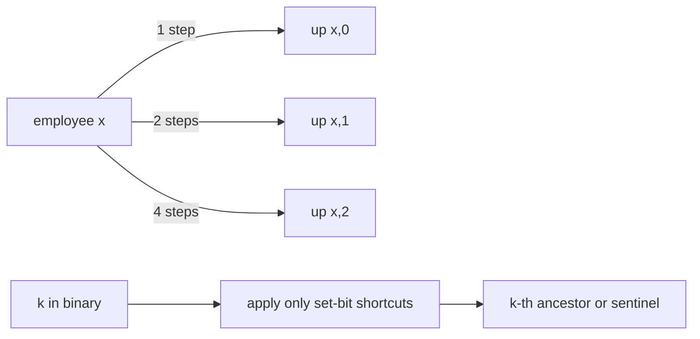

# Company Queries I

- Official problem: [CSES 1687](https://cses.fi/problemset/task/1687)
- USACO Guide ID: `cses-1687`
- Difficulty on the checked USACO Guide listing: Easy
- Listing evidence: [Binary Jump module at Guide commit `81e547a`](https://github.com/cpinitiative/usaco-guide/blob/81e547ad50a16109b5b5ed582bc6a6397479ce2b/content/5_Plat/Binary_Jump.problems.json)
- Topics: binary lifting, ancestors, trees
- Solution: [`solutions/cses-1687.cpp`](../../solutions/cses-1687.cpp)

## Paraphrased summary

Employees form a rooted company tree: every employee except the director has one immediate manager. For each independent query, report the manager exactly `k` levels above a chosen employee, or `-1` when that level lies above the director.

## Visualization

Store increasingly long upward shortcuts from every employee.

For example, moving 13 levels means combining shortcuts of lengths `8 + 4 + 1`.

## Approach

Let `up[v][j]` be the ancestor `2^j` levels above `v`. The direct manager fills column zero. For every larger column, jump halfway to `up[v][j-1]`, then use that employee's same-length shortcut. A sentinel employee `0` represents a position above the root and points to itself.

For a query, inspect the bits of `k`. Whenever bit `j` is set, replace the current employee by `up[current][j]`. Return `-1` if the result is the sentinel.

## Why it is correct

Induction on `j` proves that `up[v][j]` is exactly `2^j` levels above `v`: the base case is the given direct manager, and the transition joins two correct `2^(j-1)` jumps. The set bits of `k` are distinct powers of two whose sum is exactly `k`, so applying those table entries moves exactly `k` levels. Reaching sentinel `0` happens precisely when the requested ancestor does not exist.

## Complexity

- Preprocessing: `O(N log K)`.
- Each query: `O(log K)`.
- Memory: `O(N log K)`.

## Verification notes

The smoke test checks ordinary ancestors and a query above the root. Independent tests generate random rooted trees and compare every answer with literal parent walking. They also cover one employee, zero-distance queries, long chains, huge distances, and the maximum employee/query counts.
