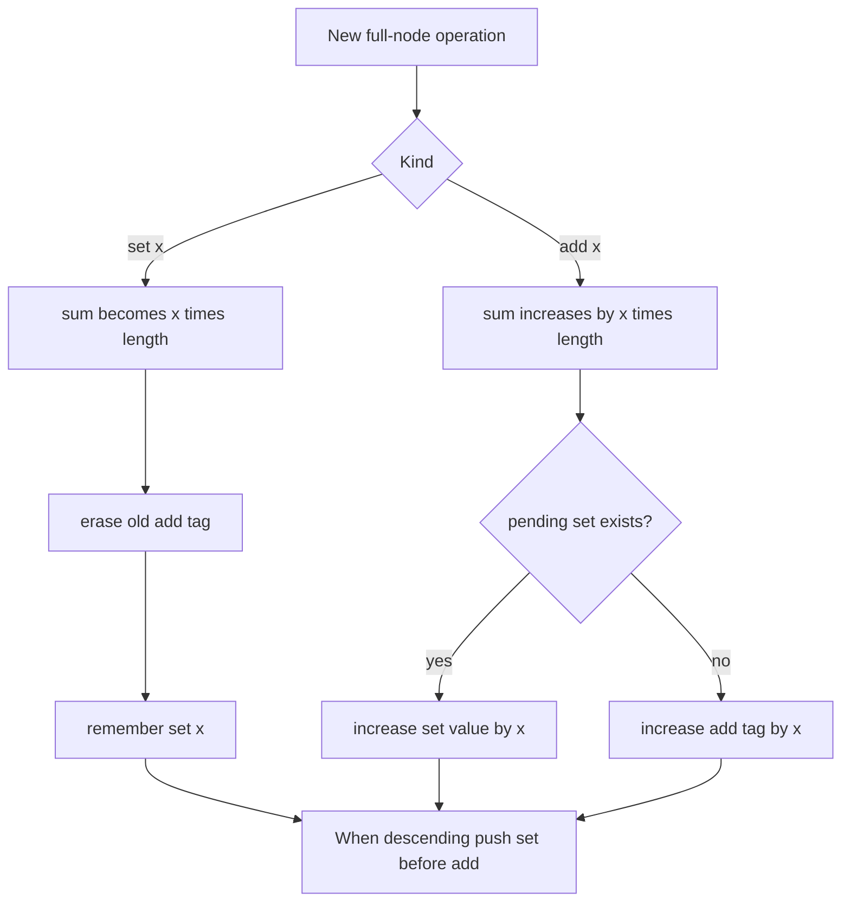

# Range Updates and Sums

- Official problem: [CSES — Range Updates and Sums](https://cses.fi/problemset/task/1735)
- USACO Guide ID: `cses-1735`
- Difficulty on the checked USACO Guide listing: Easy
- Topics: lazy segment tree, range assignment, range addition, range sum
- Solution: [`solutions/cses-1735.cpp`](../../solutions/cses-1735.cpp)

## Paraphrased summary

Maintain an array while commands add a value to an interval, replace every value in an interval, or ask for an interval sum.

## Visualization

The difficult part is composing delayed operations. A new assignment erases older pending work for that entire node. A later addition belongs on top of the assignment and can be folded into its assigned value.

## Approach

Each segment-tree node stores its interval sum, an optional pending assignment, and a pending addition. Applying an assignment sets the node sum to `value * length`, records the assignment, and clears any older addition. Applying an addition increases the node sum; if an assignment is already pending, increase that assigned value, otherwise accumulate the addition tag.

Before descending, push a pending assignment to both children first, followed by any pending addition. This preserves chronological order. Standard recursive range updates and range queries then touch only `O(log n)` nodes.

## Why it is correct

The stored sum is updated immediately whenever a full node receives an operation, so it always represents the operation's effect on that interval. The tag rules are algebraically equivalent to the original order: `set(a)` discards all earlier values, while `set(a)` followed by `add(b)` equals `set(a+b)`. Pushing assignment before addition gives each child the same ordered operations its elements should receive. By induction down the tree, every leaf represents its current array value and every internal sum is the sum of its children. Therefore every reported interval sum is correct.

## Complexity

- Build: `O(n)`.
- Each update or query: `O(log n)`.
- Space: `O(n)`.

## Verification notes

Tests compare random mixed operations with a literal array, emphasize overlapping add/set orderings and one-element ranges, include the official sample, and use `N=Q=200,000` with large updates before and after a half-array assignment.
