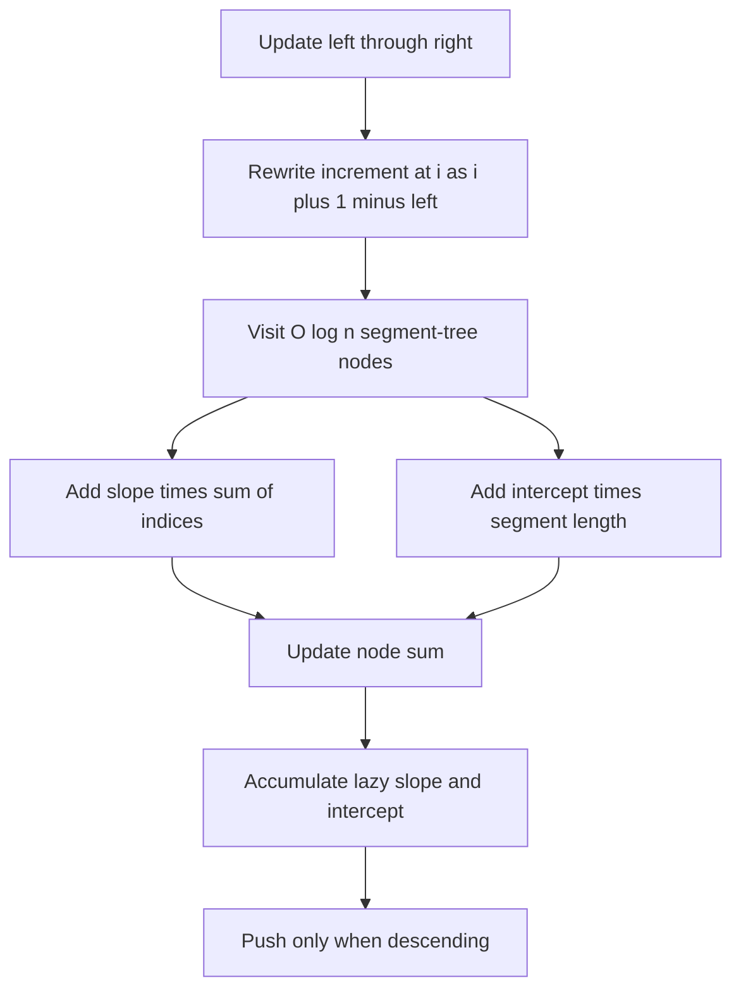

# Polynomial Queries

- Official problem: [CSES — Polynomial Queries](https://cses.fi/problemset/task/1736)
- USACO Guide ID: `cses-1736`
- Difficulty on the checked USACO Guide listing: Easy
- Topics: lazy segment tree, arithmetic progression, affine updates
- Solution: [`solutions/cses-1736.cpp`](../../solutions/cses-1736.cpp)

## Paraphrased summary

Maintain an array under two operations: add the sequence `1,2,3,...` across a chosen inclusive interval, or report the sum of a chosen inclusive interval.

## Visualization

An update starting at `l` adds `i-l+1` to absolute position `i`. That expression is a line: `1*i + (1-l)`. A segment-tree node can add the whole line over its interval using the number of indices and their sum.

## Approach

Build a segment tree containing interval sums. A lazy tag has two coefficients `(slope, intercept)` and means that position `i` still needs `slope*i + intercept` passed to descendants.

For an update `[l,r]` in zero-based coordinates, use `slope=1` and `intercept=1-l`. On a fully covered node `[a,b]`, increase its stored sum by `slope * (a+...+b) + intercept * (b-a+1)`. Add both coefficients to the node's lazy tag. Queries push pending coefficients before entering children.

## Why it is correct

For every updated position `i`, `i + (1-l)` equals `1` at `i=l`, `2` at `i=l+1`, and continues with exactly the required progression. The closed-form index sum therefore adds exactly the total of those per-position increments to every fully covered node. Lazy tags preserve the same affine function for descendants, and affine additions combine by adding their coefficients. Thus every node sum always equals the current sum of its interval, so the segment-tree query returns the requested array sum.

## Complexity

- Build: `O(n)`.
- Each update or query: `O(log n)`.
- Space: `O(n)`.

## Verification notes

Tests compare random updates and queries with direct array mutation, exercise updates beginning away from index one, single-position intervals, overlapping progressions, the official sample, and a maximum `N=Q=200,000` case whose sum requires 64-bit storage.
