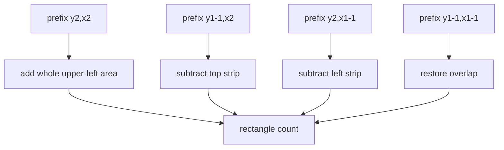

# Forest Queries II

- Official problem: [CSES — Forest Queries II](https://cses.fi/problemset/task/1739)
- USACO Guide ID: `cses-1739`
- Difficulty on the checked USACO Guide listing: Easy
- Topics: two-dimensional Fenwick tree, point updates, rectangle sums
- Solution: [`solutions/cses-1739.cpp`](../../solutions/cses-1739.cpp)

## Paraphrased summary

Maintain a square map whose cells switch between empty and occupied. Each count request asks how many occupied cells lie inside an inclusive axis-aligned rectangle.

## Visualization

A two-dimensional Fenwick prefix is a rectangle from the upper-left corner. Four such prefixes isolate any requested rectangle through inclusion-exclusion.

## Approach

Store tree cells in a 2D Fenwick tree. A toggle changes one grid value by `+1` or `-1` and updates every Fenwick rectangle that owns that point. A prefix query repeatedly removes the lowest set bit from each coordinate.

For rectangle `(y1,x1)` through `(y2,x2)`, use `P(y2,x2)-P(y1-1,x2)-P(y2,x1-1)+P(y1-1,x1-1)`. The initial Fenwick table is built in `O(N^2)` by first propagating values along `x` and then along `y`, rather than inserting all one million cells separately.

## Why it is correct

Each Fenwick cell stores the sum of its assigned low-bit rectangle. Point updates visit exactly the cells whose rectangles contain the changed position, so all summaries remain exact. A prefix query partitions its prefix rectangle into disjoint Fenwick rectangles. Inclusion-exclusion then removes the cells above and left of the requested rectangle and restores their double-subtracted overlap, leaving exactly the requested tree count.

## Complexity

- Build: `O(N^2)`.
- Each toggle or rectangle query: `O(log^2 N)`.
- Space: `O(N^2)`.

## Verification notes

Tests use the official sample, random grids compared with direct rectangle scans, repeated toggles, single-cell and full-grid rectangles, an all-empty `1000 x 1000` build, and `200,000` operations.
