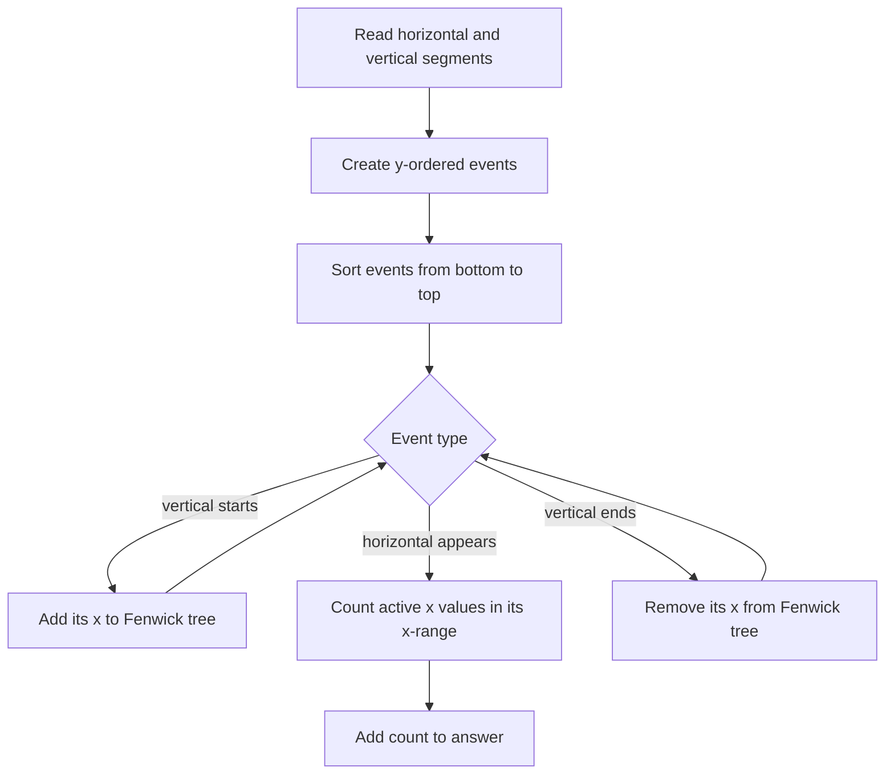

# Intersection Points

- Official problem: [CSES — Intersection Points](https://cses.fi/problemset/task/1740)
- USACO Guide ID: `cses-1740`
- Difficulty on the checked USACO Guide listing: Easy
- Topics: sweep line, Fenwick tree, coordinate compression
- Solution: [`solutions/cses-1740.cpp`](../../solutions/cses-1740.cpp)

## Paraphrased summary

Count how many crossings occur among axis-aligned line segments. The input guarantees that parallel segments do not overlap and that a crossing never lands exactly on a segment endpoint.

## Visualization

Move a horizontal scan line upward. A vertical segment is active only between its bottom and top endpoints. When the scan reaches a horizontal segment, every active vertical segment whose x-coordinate lies inside the horizontal span contributes one crossing.

## Approach

Create two events for every vertical segment: activate its x-coordinate at the lower y-coordinate and deactivate it at the upper y-coordinate. Create one query event for every horizontal segment. Sort all events by y.

The Fenwick tree stores one count for each compressed vertical x-coordinate. At a horizontal query, binary searches locate the compressed coordinate interval corresponding to `[x1, x2]`; a Fenwick range sum counts the active verticals there. The problem's endpoint guarantee removes geometric ambiguity, while start-query-end tie ordering also treats segment ranges as inclusive.

## Why it is correct

Consider a horizontal segment when its query event is processed. A vertical segment is present in the Fenwick tree exactly after the sweep has reached its lower endpoint and before it has passed its upper endpoint, which is exactly when the horizontal segment's y lies on that vertical segment. The Fenwick range query includes that vertical segment exactly when its x-coordinate lies on the horizontal segment. Therefore every counted pair intersects. Conversely, every real crossing satisfies both conditions, so its vertical segment is active and its x-coordinate is queried; that crossing is counted once. Summing all horizontal queries gives the total number of intersection points.

## Complexity

- Event sorting: `O(n log n)`.
- Fenwick processing: `O(n log n)`.
- Space: `O(n)`.

## Verification notes

Tests compare random valid horizontal/vertical collections with direct pair checking, cover all-horizontal and all-vertical inputs, negative coordinates, empty query ranges, multiple crossings on one segment, the official sample, and a `100,000`-segment case with `2,500,000,000` crossings.
