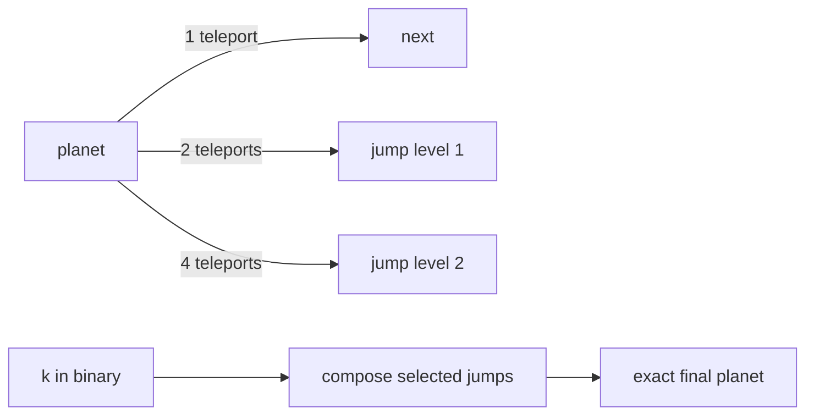

# Planets Queries I

- Official problem: [CSES 1750](https://cses.fi/problemset/task/1750)
- USACO Guide ID: `cses-1750`
- Difficulty on the checked USACO Guide listing: Easy
- Listing evidence: [Binary Jump module at Guide commit `81e547a`](https://github.com/cpinitiative/usaco-guide/blob/81e547ad50a16109b5b5ed582bc6a6397479ce2b/content/5_Plat/Binary_Jump.problems.json)
- Topics: binary lifting, functional graphs
- Solution: [`solutions/cses-1750.cpp`](../../solutions/cses-1750.cpp)

## Paraphrased summary

Every planet has one fixed teleport destination. Each query starts at a planet and follows the teleport exactly `k` times. Report the final planet, even when the route has entered and circled through a cycle many times.

## Visualization

Repeated teleports can be compressed into powers-of-two shortcuts.

The shortcut table works equally well on tails, self-loops, and longer cycles.

## Approach

Store `jump[v][j]`, the destination after `2^j` teleports from planet `v`. The given teleports fill `j = 0`; larger entries compose two half-length trips. For a query, apply `jump` entries corresponding to the set bits of `k`.

There is no need to find cycles. A precomputed jump is simply repeated function composition, which remains valid wherever the functional-graph walk happens to be.

## Why it is correct

The base table follows one real teleport. If level `j-1` is correct, following it twice performs `2^(j-1) + 2^(j-1) = 2^j` real teleports, proving every table level correct by induction. The chosen query jumps have lengths equal to the set-bit powers in `k`, so their total is exactly `k` and their composition ends at the required planet.

## Complexity

- Preprocessing: `O(N log K)`.
- Each query: `O(log K)`.
- Memory: `O(N log K)`.

## Verification notes

Tests compare random functional graphs with literal repeated teleporting for small step counts and cycle-reduced simulation for huge counts. Cases include self-loops, one large cycle, several components, a tail entering a cycle, zero steps, and maximum input sizes.
