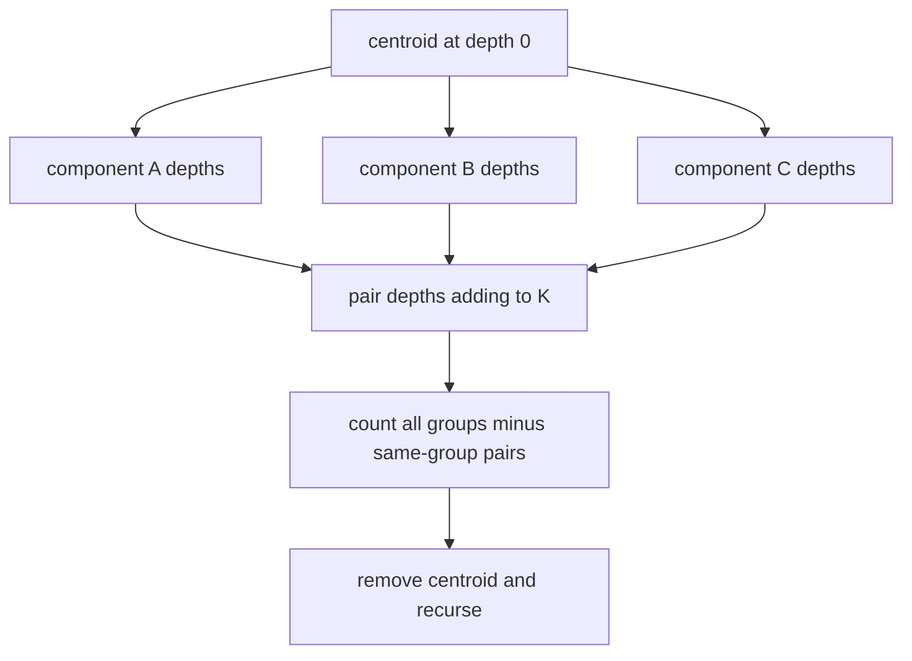

# Fixed-Length Paths I

- Official problem: [CSES 2080](https://cses.fi/problemset/task/2080)
- USACO Guide ID: `cses-2080`
- Difficulty on the checked USACO Guide listing: Easy
- Listing evidence: [Centroid Decomposition module at Guide commit `a426215`](https://github.com/cpinitiative/usaco-guide/blob/a4262152bce8c42a33ac73a631913a84b02a5ea4/content/5_Plat/Centroid.problems.json)
- Topics: centroid decomposition, tree paths, depth histograms
- Solution: [`solutions/cses-2080.cpp`](../../solutions/cses-2080.cpp)

## Paraphrased summary

Count unordered pairs of tree vertices whose unique connecting path contains exactly `K` edges.

## Visualization

At a centroid, remove the center and color each resulting neighbor component differently. A path through the centroid either starts at the centroid or connects two different colors. Its length is the sum of its endpoints' depths from the centroid.

## Approach

For one active component, find its centroid. Build a histogram of distances from the centroid for all active vertices, and a separate histogram for every neighbor component. A helper counts unordered depth pairs adding to `K`. Add the count from the combined histogram and subtract each single-component count; exactly the paths through this centroid remain. Remove the centroid and repeat in every resulting component.

All original-tree walks are iterative. Only centroid-decomposition calls recurse, and their depth is logarithmic.

## Why it is correct

Every tree path has a unique first centroid removed from among its vertices. At that decomposition step, its endpoints are either the centroid and another vertex or lie in two different neighbor components, so their depths add to the path length and the combined histogram counts them. Same-neighbor pairs do not pass through the centroid and are subtracted. The path cannot be counted at any later step because its endpoints are separated or the centroid is removed, and it was not counted earlier because both endpoints were in one earlier component. Therefore each length-`K` path is counted exactly once.

## Complexity

- Time: `O(N log N)`.
- Memory: `O(N)` plus temporary component histograms.

## Verification notes

Random trees use BFS distances for every unordered vertex pair as an independent oracle. Samples, stars, chains, `K=1`, and impossible `K=N` are covered. A 200,000-node chain checks the official maximum and recursion safety.
