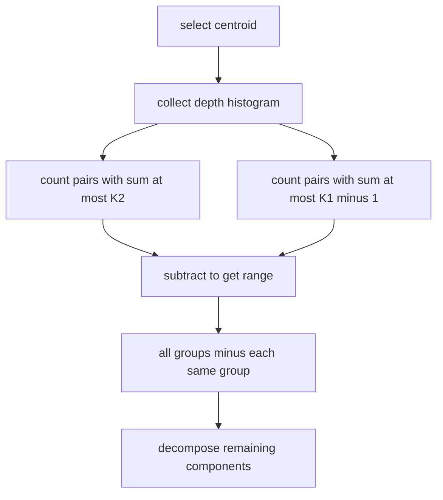

# Fixed-Length Paths II

- Official problem: [CSES 2081](https://cses.fi/problemset/task/2081)
- USACO Guide ID: `cses-2081`
- Difficulty on the checked USACO Guide listing: Easy
- Listing evidence: [Centroid Decomposition module at Guide commit `a426215`](https://github.com/cpinitiative/usaco-guide/blob/a4262152bce8c42a33ac73a631913a84b02a5ea4/content/5_Plat/Centroid.problems.json)
- Topics: centroid decomposition, tree paths, depth histograms, prefix counts
- Solution: [`solutions/cses-2081.cpp`](../../solutions/cses-2081.cpp)

## Paraphrased summary

Count unordered pairs of tree vertices whose unique path length lies between `K1` and `K2`, inclusive.

## Visualization

The centroid turns path length into a sum of two depths. Histogram prefix counts answer how many partners place that sum inside the requested interval.

## Approach

Use the same combined-minus-single-groups centroid decomposition as the exact-length version. For one histogram, compute `pairs_at_most(limit)` from prefix counts: for every smaller endpoint depth `d`, count larger depths through `limit-d`, and separately add equal-depth combinations. The inclusive interval count is `pairs_at_most(K2) - pairs_at_most(K1-1)`.

Depths larger than `K2` are pruned because they cannot belong to a qualifying path. Histograms are indexed directly by depth, avoiding a logarithmic query for every vertex.

## Why it is correct

At a centroid step, combined histograms count every depth pair whose sum is in the interval. Subtracting each neighbor's histogram removes precisely the pairs whose actual path stays inside one neighbor component instead of passing through the centroid. The remaining pairs have actual length equal to the depth sum. Assigning each path to the earliest removed centroid on it proves that every valid path is counted once and invalid paths are never counted.

## Complexity

- Time: `O(N log N)` because each decomposition level scans linear total histogram size.
- Memory: `O(N)`.

## Verification notes

Random trees compare against literal BFS all-pairs distances for many intervals, including single-length ranges and ranges above the tree diameter. A 200,000-node chain verifies maximum input size and has the closed-form answer `sum(N-d)` over allowed distances.
