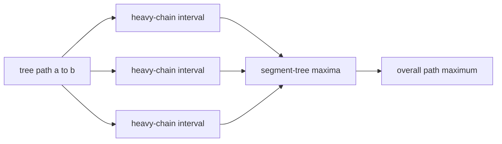

# Path Queries II

- Official problem: [CSES 2134](https://cses.fi/problemset/task/2134)
- USACO Guide ID: `cses-2134`
- Difficulty on the checked USACO Guide listing: Easy
- Listing evidence: [Heavy-Light Decomposition module at Guide commit `81e547a`](https://github.com/cpinitiative/usaco-guide/blob/81e547ad50a16109b5b5ed582bc6a6397479ce2b/content/5_Plat/HLD.problems.json)
- Topics: heavy-light decomposition, segment tree, path maximum
- Solution: [`solutions/cses-2134.cpp`](../../solutions/cses-2134.cpp)

## Paraphrased summary

Each tree vertex stores a positive value. Updates replace one vertex value, while path queries ask for the maximum value among every vertex on the unique route between two endpoints.

## Visualization

Heavy edges keep large subtrees together, turning a tree route into a small number of array intervals.

Every time the query crosses between chains, it moves across a light edge. Subtree sizes at least halve, so only logarithmically many chains can appear.

## Approach

First root the tree, compute subtree sizes bottom-up, and mark each vertex's largest child as heavy. Assign consecutive array positions while following heavy edges, and start a new chain at every light child. Store vertex values in a maximum segment tree using these positions.

For a route query, while the endpoints belong to different chains, query the deeper endpoint's chain suffix and jump that endpoint to the chain head's parent. Once both endpoints share a chain, query the single interval between their positions. A point update changes one segment-tree leaf.

## Why it is correct

Within a heavy chain, vertices occur consecutively in ancestor-to-descendant order, so a segment-tree interval contains exactly that route portion. Removing the deeper chain suffix preserves the unprocessed route between the new endpoints. Repeating this step eventually places both endpoints in one chain; the final interval covers the remaining route. These disjoint pieces partition the original path, and taking their maxima therefore gives the path maximum. Point assignments update the one array position representing that vertex.

## Complexity

- Preprocessing: `O(N log N)` including segment-tree construction by point assignments.
- Update: `O(log N)`.
- Path maximum: `O(log^2 N)`.
- Memory: `O(N)`.

## Verification notes

Random tests reconstruct every queried path and scan current values directly. A 200,000-node chain with 200,000 operations checks iterative traversal, a single long heavy chain, maximum values, repeated queries, and point updates.
