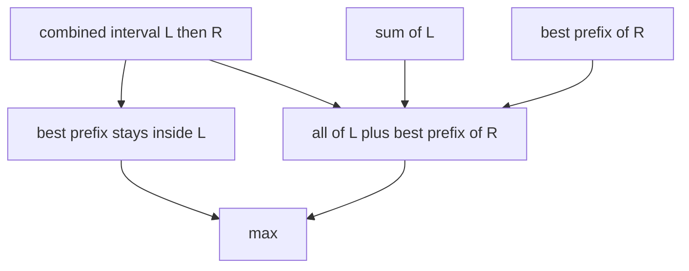

# Prefix Sum Queries

- Official problem: [CSES — Prefix Sum Queries](https://cses.fi/problemset/task/2166)
- USACO Guide ID: `cses-2166`
- Difficulty on the checked USACO Guide listing: Easy
- Topics: segment tree, maximum prefix sum, point update
- Solution: [`solutions/cses-2166.cpp`](../../solutions/cses-2166.cpp)

## Paraphrased summary

Maintain a signed array under point replacements. For a requested interval, report the largest sum obtainable by taking a prefix of that interval; choosing no elements is allowed and gives zero.

## Visualization

For a joined interval, the best prefix either stops somewhere in the left half or consumes all of the left half and continues with the right half's best prefix.

## Approach

Store two values per segment-tree node: the complete interval sum and its maximum prefix sum with the empty prefix allowed. Merge left then right with `sum=L.sum+R.sum` and `best=max(L.best, L.sum+R.best)`. A leaf holding `x` becomes `(x,max(0,x))`.

Point replacement updates one root-to-leaf path. A range query merges its selected nodes in their original left-to-right order. The neutral node `(0,0)` is safe because every stored best prefix is nonnegative and at least the full interval sum.

## Why it is correct

Every prefix of a concatenation `L+R` has exactly one of two forms: it ends in `L`, or it contains all of `L` followed by a prefix of `R`. The merge formula takes the best value from those exhaustive cases. Leaves are correct by directly comparing their one nonempty prefix with the allowed empty prefix. Induction through build, update, and ordered query merges proves that every returned node has the correct sum and best prefix, so the printed value is correct.

## Complexity

- Build: `O(N)`.
- Each replacement or query: `O(log N)`.
- Space: `O(N)`.

## Verification notes

Tests compare random replacements and interval queries with direct prefix scans, cover all-negative ranges where the answer is zero, include the official sample, and use `N=Q=200,000` with extreme values.
