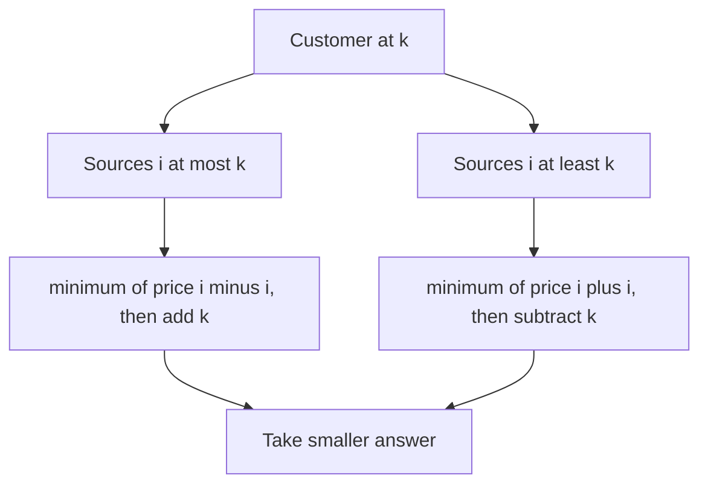

# Pizzeria Queries

- Official problem: [CSES 2206 — Pizzeria Queries](https://cses.fi/problemset/task/2206)
- USACO Guide ID: `cses-2206`
- Difficulty on the checked USACO Guide listing: Easy
- Topics: segment tree, transformed minima, point updates
- Solution: [`solutions/cses-2206.cpp`](../../solutions/cses-2206.cpp)

## Paraphrased summary

Every building has a pizzeria with a changeable base price. From building `k`, ordering from building `i` costs that price plus the street distance `|i-k|`. Process price changes and minimum delivered-price questions.

## Visualization

Split possible pizzerias at the customer's building. On each side, remove the absolute value and query a transformed minimum.

## Approach

1. For every position `i`, store both `price[i]-i` and `price[i]+i`.
2. A segment-tree node stores the minimum of each transformed value in its interval.
3. For a customer at `k`, query `price[i]-i` over `i <= k` and add `k`.
4. Query `price[i]+i` over `i >= k` and subtract `k`.
5. The smaller candidate is the cheapest delivered pizza.
6. A price update changes both values at one leaf and recomputes its ancestors.

## Why it is correct

For every pizzeria left of or at `k`, delivery cost equals `price[i] + k-i = (price[i]-i)+k`, so the left range minimum gives the cheapest such source. For every pizzeria right of or at `k`, the cost equals `price[i] + i-k = (price[i]+i)-k`, so the right range minimum gives the cheapest source on that side. Every building belongs to at least one of these ranges, and taking the smaller of their exact minima gives the global optimum. Point updates restore both transformed minima on every affected segment.

## Complexity

- Build: `O(n)`.
- Update or price query: `O(log n)`.
- Space: `O(n)`.

## Verification notes

The verifier includes the official example, boundary customers, repeated updates, equal-price ties, random operation streams checked by scanning every pizzeria, and a 200,000-operation scale case.
