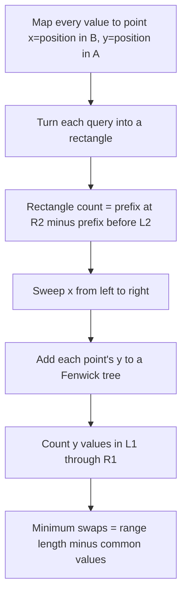

# Twin Permutations

- Official problem: [HackerEarth — Mancunian and Twin Permutations](https://www.hackerearth.com/practice/data-structures/advanced-data-structures/fenwick-binary-indexed-trees/practice-problems/algorithm/mancunian-and-twin-permutations-d988930c/)
- USACO Guide ID: `he-TwinPermutations`
- Difficulty on the checked USACO Guide listing: Easy
- Topics: offline queries, sweep line, Fenwick tree, permutations
- Solution: [`solutions/he-TwinPermutations.cpp`](../../solutions/he-TwinPermutations.cpp)

## Paraphrased summary

Two arrays are permutations of the same values. Each query selects equal-length subarrays, one from each permutation. Find the minimum number of arbitrary swaps in the first permutation needed to make its selected subarray contain the same values as the selected subarray of the second permutation.

## Visualization

Represent each value by one point. Its x-coordinate is its position in the second permutation, and its y-coordinate is its position in the first. A query asks how many points lie in the rectangle formed by its two index ranges.

## Approach

Invert the first permutation so every value maps to its position. Transform the second permutation into a sequence of those first-permutation positions. Now the number of shared values between `A[L1..R1]` and `B[L2..R2]` is the number of transformed entries in positions `L2..R2` whose values lie in `L1..R1`.

Answer all such two-dimensional range counts offline. Split each query into a positive event at second-prefix `R2` and a negative event at prefix `L2-1`. Sweep through the transformed second permutation while a Fenwick tree counts seen first-permutation positions. The signed difference is the intersection size. Subtract that count from the common subarray length.

## Why it is correct

The point for a value lies inside a query rectangle exactly when that value appears in both selected subarrays, so the rectangle count equals the number of values the subarrays already share. The offline prefix difference counts exactly the points whose second-permutation positions lie from `L2` through `R2`, and the Fenwick range sum keeps exactly those whose first-permutation positions lie from `L1` through `R1`.

All shared values can remain. Every other position inside the first subarray contains an unwanted value, and every missing target value lies outside it. One arbitrary swap pairs one unwanted inside value with one missing outside value. Thus `length - shared` swaps are sufficient, and no solution can use fewer because one swap can introduce at most one missing target value. The reported number is therefore minimal.

## Complexity

- Preprocessing and event creation: `O(n + q)`.
- Sweep: `O((n + q) log n)`.
- Space: `O(n + q)`.

## Verification notes

Tests compare random permutations and ranges with direct set intersections, cover identical and reversed permutations, single-element and full-range queries, zero-swap cases, disjoint selected sets, the documented input limits, and `100,000` full-range queries.
