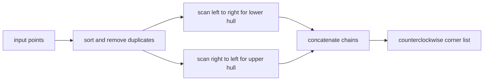

# Convex Hull

- Official problem: [Kattis — Convex Hull](https://open.kattis.com/problems/convexhull)
- USACO Guide ID: `kattis-convexhull`
- Difficulty on the checked USACO Guide listing: Easy
- Listing evidence: [Convex Hull module at Guide commit `70bfb31`](https://github.com/cpinitiative/usaco-guide/blob/70bfb314cd0be2e8102215a8a3efb0a8cc558a06/content/5_Plat/Convex_Hull.problems.json)
- Topics: computational geometry, convex hull, monotone chain
- Solution: [`solutions/kattis-convexhull.cpp`](../../solutions/kattis-convexhull.cpp)

## Paraphrased summary

For each set of integer points, print the corner vertices of its smallest enclosing convex polygon in counterclockwise order. Repeated points and points lying in the middle of a straight hull edge must not create extra vertices.

## Visualization

Imagine the points as nails. A tight rubber band touches only the outer corners. After sorting the nails from left to right, build the bottom band and then the top band. Whenever the newest three points bend inward or continue straight, remove the middle one.

## Approach

1. Sort points by `(x,y)` and erase duplicates.
2. Scan left to right. Before adding a point, pop while the last two hull points and the new point do not make a strict left turn.
3. Scan right to left with the same rule to build the upper chain.
4. Remove the repeated starting vertex and print the remaining list.

Using `cross(a,b,c) <= 0` removes both clockwise bends and middle points on collinear edges.

## Why it is correct

During the lower scan, the stack is always a left-turning chain. If `a,b,c` do not make a strict left turn, `b` lies on or above segment `ac`, so it cannot be a necessary lower supporting corner; removing it keeps every processed point on or above the chain. Thus the finished stack is exactly the lower convex boundary. The reverse scan proves the same fact for the upper boundary. Their shared endpoints join the two boundaries into the complete convex hull, in counterclockwise order, with no collinear consecutive edges.

## Complexity

- Time: `O(N log N)` per test case because of sorting.
- Memory: `O(N)`.

## Verification notes

Smoke tests cover a square with interior and repeated points, a fully collinear case, and a singleton. Randomized tests compare the printed vertex cycle against an independent Python monotone-chain oracle and check strict counterclockwise turns.
