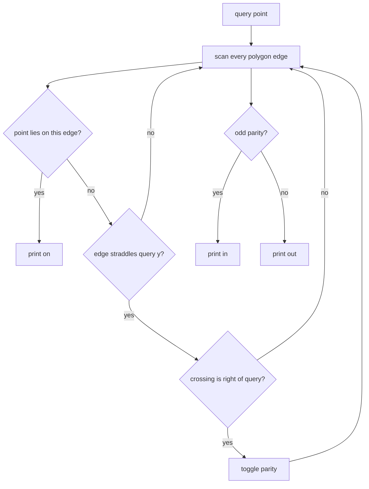

# Point in Polygon

- Official problem: [Kattis — Point in Polygon](https://open.kattis.com/problems/pointinpolygon)
- USACO Guide ID: `kattis-pointinpolygon`
- Difficulty on the checked USACO Guide listing: Easy
- Listing evidence: [Geometry Primitives module at Guide commit `a426215`](https://github.com/cpinitiative/usaco-guide/blob/a4262152bce8c42a33ac73a631913a84b02a5ea4/content/5_Plat/Geo_Pri.problems.json)
- Topics: computational geometry, ray casting, orientation
- Solution: [`solutions/kattis-pointinpolygon.cpp`](../../solutions/kattis-pointinpolygon.cpp)

## Paraphrased summary

Given a simple polygon and several query points, label every query as strictly inside, exactly on the boundary, or outside. Input can contain multiple polygons and ends with a zero vertex count.

## Visualization

Cast a horizontal ray from the query toward positive x. Crossing the polygon boundary toggles between outside and inside. A half-open vertical rule makes a ray through a vertex count exactly once.

## Approach

1. Check every edge with an exact cross product and coordinate ranges; if the query is on any edge, answer `on` immediately.
2. Otherwise consider only edges whose endpoints lie on opposite sides of the query's horizontal line, using `(a.y > q.y) != (b.y > q.y)`.
3. Use the orientation sign and the edge direction to decide whether that edge crosses the ray to the right, without division.
4. Toggle a Boolean for every such crossing. Odd parity means `in`; even parity means `out`.

## Why it is correct

The explicit on-segment test recognizes exactly the boundary points. For every other query, moving along a ray from the query to infinity changes between inside and outside at each genuine boundary crossing. The half-open y rule assigns a polygon vertex to only one incident edge, so every crossing is counted once. The orientation-direction test is algebraically equivalent to asking whether the edge's intersection with the query's horizontal line has greater x. Thus odd parity is exactly inside and even parity is outside.

## Complexity

- Time: `O(N)` per query for a polygon with `N` vertices.
- Memory: `O(N)` for the polygon.

## Verification notes

Tests cover convex and concave polygons, horizontal and vertical edges, queries at vertices and along edges, rays aligned with vertices, the official sample, and randomized integer points checked by an independent exact parity oracle.
