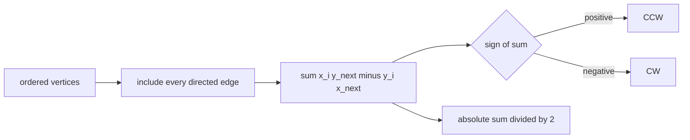

# Polygon Area

- Official problem: [Kattis — Polygon Area](https://open.kattis.com/problems/polygonarea)
- USACO Guide ID: `kattis-polygonarea`
- Difficulty on the checked USACO Guide listing: Easy
- Listing evidence: [Geometry Primitives module at Guide commit `a426215`](https://github.com/cpinitiative/usaco-guide/blob/a4262152bce8c42a33ac73a631913a84b02a5ea4/content/5_Plat/Geo_Pri.problems.json)
- Topics: computational geometry, shoelace formula, polygon orientation
- Solution: [`solutions/kattis-polygonarea.cpp`](../../solutions/kattis-polygonarea.cpp)

## Paraphrased summary

For each simple polygon, report whether its vertices are ordered clockwise or counterclockwise and print its area with one digit after the decimal point. A zero vertex count ends the input.

## Visualization

Each directed polygon edge contributes a signed trapezoid-like term `x_i*y_(i+1) - y_i*x_(i+1)`. Adding the terms cancels the exterior pieces and leaves twice the signed polygon area.

## Approach

1. Loop over every vertex `i`, pairing it with `(i+1) mod N`.
2. Add `x_i*y_(i+1) - y_i*x_(i+1)` to a `__int128` sum.
3. A positive sum means counterclockwise order; a negative sum means clockwise order.
4. The absolute sum is twice the area. Print integer division by two followed by `.0` for even sums or `.5` for odd sums.

## Why it is correct

The shoelace theorem states that the directed cross-product sum over the closed polygon boundary equals twice its signed area. Reversing the traversal reverses every edge direction and the sign, so the sign identifies orientation. Taking the magnitude removes orientation and dividing by two gives the ordinary area. Integer coordinates make the doubled area integral, so the last digit must be `.0` or `.5`.

## Complexity

- Time: `O(N)` per polygon.
- Memory: `O(N)` for the stored vertices.

## Verification notes

Tests include triangles, concave polygons, translated shapes, both traversal directions, half-unit areas, the official sample, and randomized simple rectangles/triangles checked with an independent shoelace calculation.
