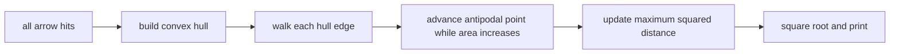

# Robert Hood

- Official problem: [Kattis — Robert Hood](https://open.kattis.com/problems/roberthood)
- USACO Guide ID: `kattis-roberthood`
- Difficulty on the checked USACO Guide listing: Easy
- Listing evidence: [Convex Hull module at Guide commit `70bfb31`](https://github.com/cpinitiative/usaco-guide/blob/70bfb314cd0be2e8102215a8a3efb0a8cc558a06/content/5_Plat/Convex_Hull.problems.json)
- Topics: convex hull, rotating calipers, farthest pair
- Solution: [`solutions/kattis-roberthood.cpp`](../../solutions/kattis-roberthood.cpp)

## Paraphrased summary

Given the Cartesian coordinates of a contestant's arrow hits, find the greatest Euclidean distance between any two hit positions.

## Visualization

Interior points can never be farther apart than the outer boundary. Wrap a tight band around the points, then place two parallel supporting lines against the hull. As one line follows each hull edge, slide the opposite contact forward while the enclosed triangle area grows.

## Approach

1. Build a strict counterclockwise convex hull with monotone chain.
2. For every hull edge `(i,i+1)`, maintain an opposite index `j`.
3. Advance `j` while the absolute cross product, which is twice the triangle area over that edge, increases.
4. Test distances from both edge endpoints to `j` and retain the largest squared distance.
5. Print its square root.

## Why it is correct

A farthest point pair cannot contain a strictly interior point: moving from that point along the line away from its partner reaches the hull and does not shorten the distance. Therefore some diameter pair lies entirely on the convex hull. For a fixed hull edge, the area to successive opposite vertices increases and then decreases, so rotating calipers stops at an antipodal supporting vertex. Every hull diameter is represented when its supporting edge is processed, and checking both edge endpoints records its squared length. Taking the maximum and square root yields the required distance.

## Complexity

- Time: `O(N log N)` for the hull plus `O(H)` for calipers.
- Memory: `O(N)`.

## Verification notes

Tests include two points, duplicate positions, collinear points, rectangles, and random point clouds. An independent all-pairs oracle checks the exact squared diameter before floating-point formatting.
