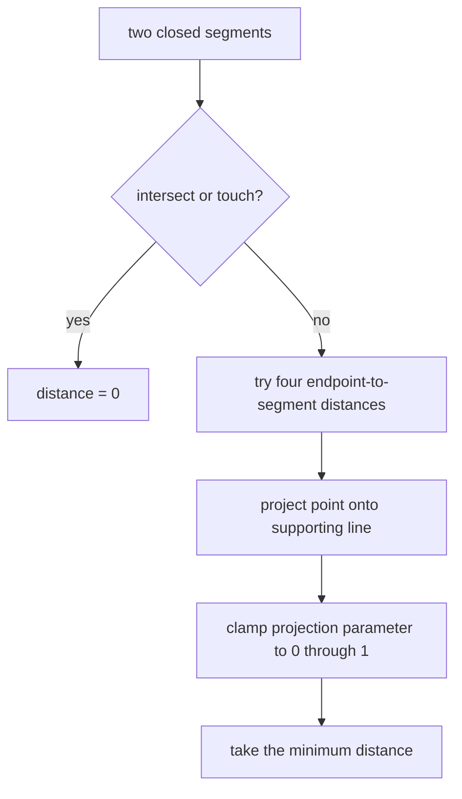

# Segment Distance

- Official problem: [Kattis — Segment Distance](https://open.kattis.com/problems/segmentdistance)
- USACO Guide ID: `kattis-segmentdistance`
- Difficulty on the checked USACO Guide listing: Easy
- Listing evidence: [Geometry Primitives module at Guide commit `a426215`](https://github.com/cpinitiative/usaco-guide/blob/a4262152bce8c42a33ac73a631913a84b02a5ea4/content/5_Plat/Geo_Pri.problems.json)
- Topics: computational geometry, projections, segment intersection
- Solution: [`solutions/kattis-segmentdistance.cpp`](../../solutions/kattis-segmentdistance.cpp)

## Paraphrased summary

For each pair of closed line segments, compute the smallest Euclidean distance between any point on the first segment and any point on the second. Print the result to two decimal places.

## Visualization

If the segments touch or cross, the answer is zero. Otherwise imagine dropping a perpendicular from an endpoint to the other segment. The perpendicular foot is used when it lands between the segment's endpoints; otherwise the nearest endpoint is used.

## Approach

1. Use exact `__int128` orientation tests to detect proper crossings, endpoint touches, collinear overlap, and degenerate point segments.
2. If the segments intersect, print zero.
3. For a point `P` and segment `AB`, compute `t = dot(P-A, B-A) / |B-A|^2` and clamp `t` to `[0,1]`.
4. Measure from `P` to `A + t(B-A)`.
5. Return the minimum for both endpoints of each segment against the other segment.

## Why it is correct

Intersecting closed segments share a point, so their minimum distance is zero. For disjoint segments, minimizing the squared distance over the two segment parameters is a convex problem. If neither closest point were an endpoint, both supporting lines would have a common perpendicular in the plane; for nonparallel lines that means an intersection, while parallel lines have an equally close pair that includes an endpoint. Therefore one of the four endpoint-to-segment distances attains the minimum. Clamping the projection returns exactly the closest point on a closed segment.

## Complexity

- Time: `O(1)` per test case.
- Memory: `O(1)`.

## Verification notes

Tests include proper crossings, collinear overlap, shared endpoints, parallel and skew disjoint segments, zero-length segments, the official sample, and randomized comparisons against an independent projection/intersection oracle.
