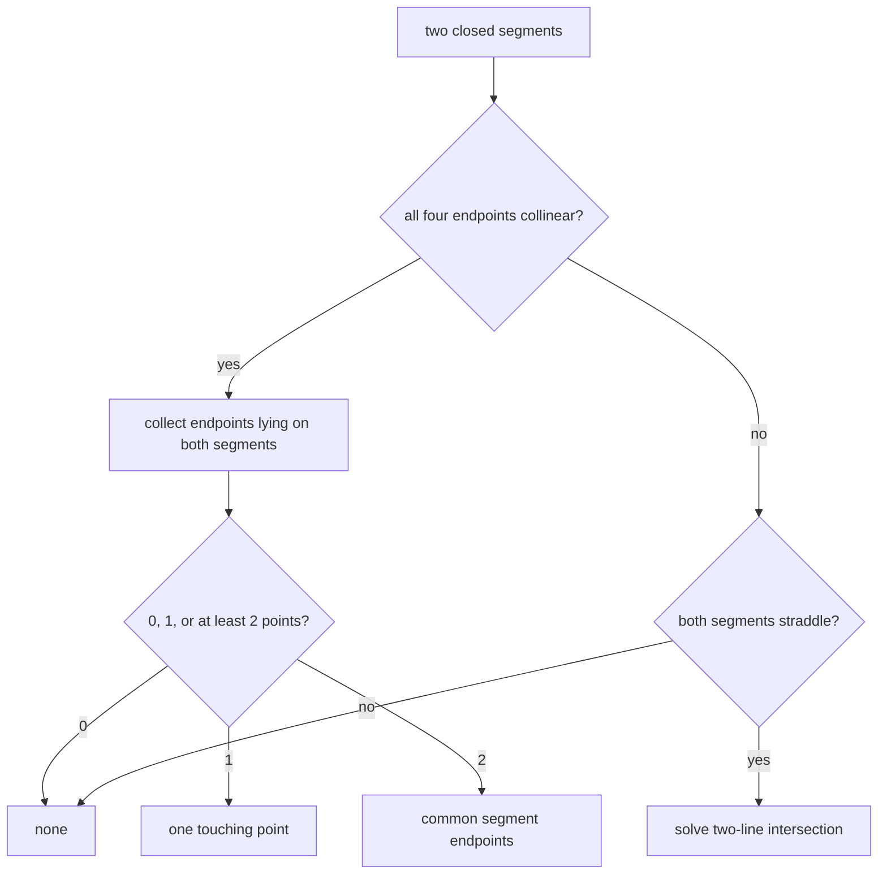

# Segment Intersection

- Official problem: [Kattis — Segment Intersection](https://open.kattis.com/problems/segmentintersection)
- USACO Guide ID: `kattis-segmentintersection`
- Difficulty on the checked USACO Guide listing: Easy
- Listing evidence: [Geometry Primitives module at Guide commit `a426215`](https://github.com/cpinitiative/usaco-guide/blob/a4262152bce8c42a33ac73a631913a84b02a5ea4/content/5_Plat/Geo_Pri.problems.json)
- Topics: computational geometry, orientation, line intersection
- Solution: [`solutions/kattis-segmentintersection.cpp`](../../solutions/kattis-segmentintersection.cpp)

## Paraphrased summary

For each pair of closed line segments, print their common part: `none`, one intersection point, or the two ordered endpoints of an overlapping collinear segment. Coordinates are printed to two decimal places when the intersection is not already represented by integer overlap endpoints.

## Visualization

Four orientation tests decide whether each segment straddles the other segment's supporting line. Parallel collinear segments instead reduce to overlapping one-dimensional endpoint intervals.

## Approach

1. Use exact `__int128` cross products for orientation and on-segment checks.
2. If all relevant orientations are zero, collect every input endpoint that lies on both segments. A sorted set produces zero, one, or two extreme common endpoints and also handles point segments.
3. Otherwise, require each segment's endpoints to lie on opposite sides of, or on, the other supporting line.
4. If they straddle, solve `A + t(B-A) = C + u(D-C)` for `t` using long double and print the unique point to two decimals.
5. Normalize tiny values to zero so the output never contains `-0.00`.

## Why it is correct

Nonparallel segments intersect exactly when each closed segment straddles the other's supporting line; the linear equation then has one unique solution contained in both. Parallel noncollinear segments have no common point. Collinear intersections are intervals whose endpoints must be among the four original endpoints, so collecting endpoints that lie on both segments returns exactly the common point or the two extremes of the common interval. These cases are exhaustive and disjoint.

## Complexity

- Time: `O(1)` per test case.
- Memory: `O(1)` apart from a set of at most four points.

## Verification notes

Tests cover proper crossings, endpoint touches, disjoint parallel lines, partial and full overlap, reversed endpoints, vertical segments, point segments, and 1,000 random small-coordinate cases. A rational-arithmetic Python oracle checks both the intersection kind and rounded coordinates.
