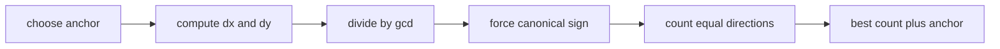

# Max Points on a Line

- Official problem: [LeetCode 149 — Max Points on a Line](https://leetcode.com/problems/max-points-on-a-line/description/)
- USACO Guide ID: `leetcode-149`
- Difficulty on the checked USACO Guide listing: Easy
- Listing evidence: [Geometry Primitives module at Guide commit `5addb3e`](https://github.com/cpinitiative/usaco-guide/blob/5addb3eedcaddea38292dd70129482ae7057155c/content/5_Plat/Geo_Pri.problems.json)
- Topics: computational geometry, complete search, normalized slopes
- Solution: [`solutions/leetcode-149.cpp`](../../solutions/leetcode-149.cpp)

## Paraphrased summary

Given distinct integer points in the plane, find the largest number that can lie on one infinite straight line. The local wrapper reads the number of points followed by their coordinates.

## Visualization

Choose one point as an anchor and imagine rays going to every other point. Points on the same line produce direction vectors that differ only by scale or sign. Reducing each vector by its greatest common divisor turns them into one shared key.

## Approach

1. Fix every point in turn as the anchor.
2. For each later point, compute `(dx,dy)` from the anchor.
3. Divide both components by `gcd(|dx|,|dy|)`.
4. Flip both signs when needed so opposite vectors have the same representation.
5. Count equal reduced directions and add one for the anchor.

## Why it is correct

For a fixed anchor, two other points are collinear with it exactly when their direction vectors are scalar multiples. GCD reduction removes every positive integer scale, and sign normalization also identifies negative multiples, so equal keys mean exactly the same line through the anchor. Every global best line has a first point in index order; when that point is the anchor, every other point on the line is counted together. Taking the maximum therefore returns the largest collinear set.

## Complexity

- Time: `O(N^2 log N)` with an ordered map; `N <= 300`.
- Memory: `O(N)` direction keys for one anchor.

## Verification notes

Checks include one point, vertical and horizontal lines, negative slopes, parallel lines with different intercepts, the official examples, and randomized distinct point sets compared with an independent cross-product oracle.
