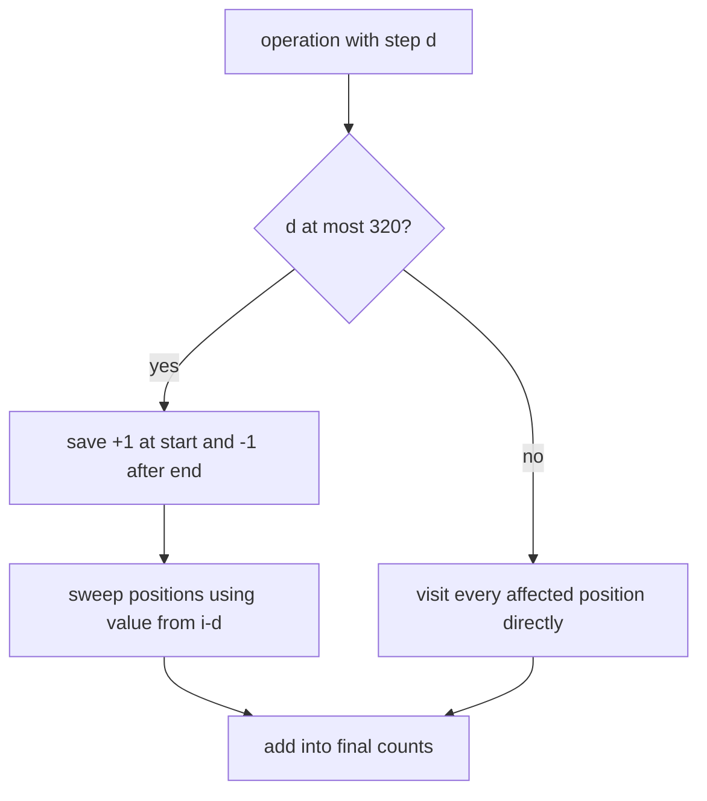

# 2017 - Containers

- Official problem: [POI 2017 Containers](https://szkopul.edu.pl/problemset/problem/oNnWY6ZuzzhvG-jCmijiXkIk/site/?key=statement)
- USACO Guide ID: `poi-17-containers`
- Difficulty on the checked USACO Guide listing: Easy
- Topics: square-root decomposition, arithmetic progressions, difference arrays
- Solution: [`solutions/poi-17-containers.cpp`](../../solutions/poi-17-containers.cpp)

## Paraphrased summary

A ramp has `N` positions. Each operation places one container at a starting position and then at a fixed step for a specified number of placements. Report the total containers at every position after all operations.

## Visualization

Small steps are dense, so combine their progressions as difference events along residue-class chains. Large steps are sparse, so visit their few affected positions directly.

## Approach

Use threshold 320. Group every operation with a step at most the threshold. For one grouped step `d`, place `+1` at each start and `-1` one step after each progression's last position. Sweep from left to right, adding the value at `i-d`; this is a prefix sum along each residue class modulo `d`. Add the resulting active count into the answer.

For a step above the threshold, explicitly visit its positions. Such an operation touches fewer than `N / 320` cells. Reuse one difference buffer for every small step to stay well below the memory limit.

## Why it is correct

For a fixed small step, the recurrence propagates each start event through exactly its arithmetic progression, while the stop event cancels it immediately afterward. Thus every grouped operation contributes one precisely where required. Large-step operations are simulated literally. Adding both categories gives the total contribution of every operation at every ramp position.

## Complexity

- Time: `O(320N + KN/320)` in the worst case.
- Memory: `O(N + K)`.

## Verification notes

Random operations are checked against direct placement. Tests cover length-one operations, overlapping residue classes, the official sample, and maximum `N` and `K` with mixed small and large steps.
