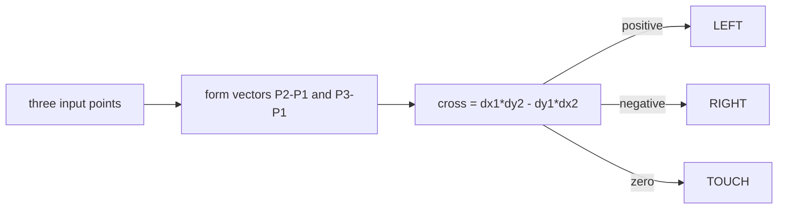

# Point Location Test

- Official problem: [CSES 2189](https://cses.fi/problemset/task/2189)
- USACO Guide ID: `point`
- Difficulty on the checked USACO Guide listing: Easy
- Listing evidence: [Geometry Primitives module at Guide commit `a426215`](https://github.com/cpinitiative/usaco-guide/blob/a4262152bce8c42a33ac73a631913a84b02a5ea4/content/5_Plat/Geo_Pri.problems.json)
- Topics: computational geometry, orientation, cross product
- Solution: [`solutions/point.cpp`](../../solutions/point.cpp)

## Paraphrased summary

For each query, look along the directed line from `P1` to `P2` and report whether `P3` is on its left, on its right, or exactly on the line.

## Visualization

Translate the picture so `P1` is the origin. The signed area of the parallelogram formed by vectors `P1→P2` and `P1→P3` gives the turn direction.

Reversing `P1` and `P2` reverses the viewing direction and therefore swaps left and right. Translating or rotating the entire picture does not change the sign.

## Approach

Compute

`(x2-x1)(y3-y1) - (y2-y1)(x3-x1)`.

A positive result is a counterclockwise turn (`LEFT`), a negative result is clockwise (`RIGHT`), and zero means collinear (`TOUCH`). Use exact integer arithmetic; `__int128` safely covers all coordinate differences and products.

## Why it is correct

The cross product is positive exactly when the second vector lies counterclockwise from the first by an angle between 0 and 180 degrees, which is the left half-plane when viewing from `P1` to `P2`. Its sign is negative in the right half-plane and zero exactly when the vectors are parallel, so the three outputs match all possible point positions.

## Complexity

- Time: `O(T)` total, `O(1)` per test.
- Memory: `O(1)`.

## Verification notes

Tests include the official sample, horizontal and vertical lines, reversed direction, collinear points, random coordinates, and `±10^9` extremes. A Python big-integer cross product is the independent oracle.
